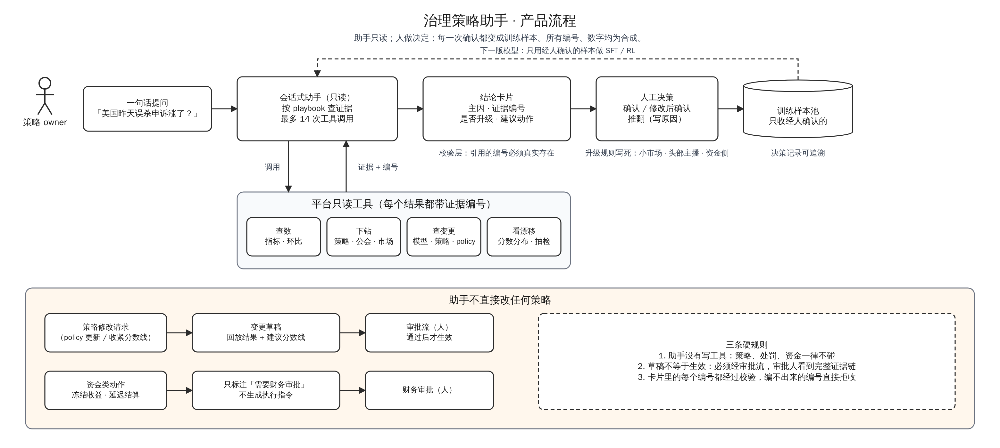
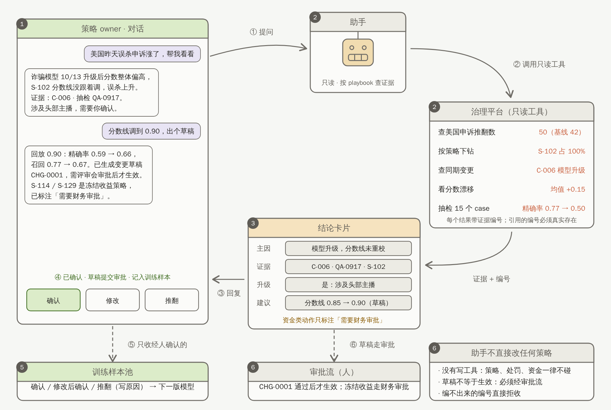
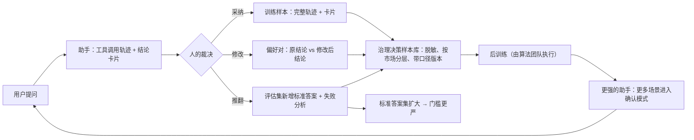
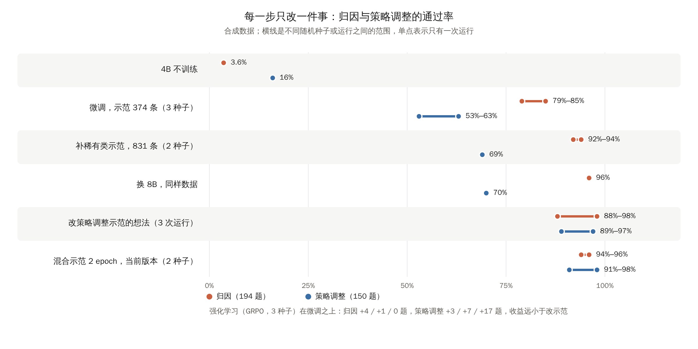
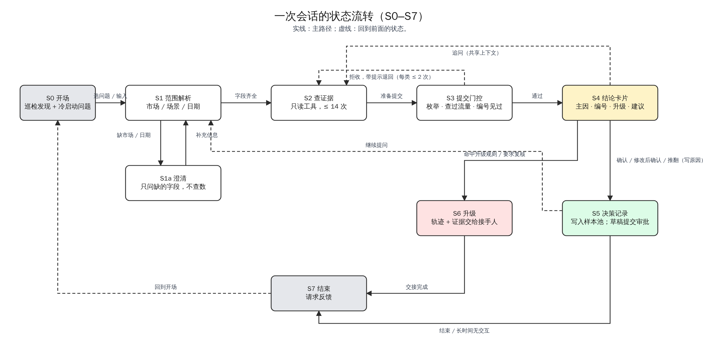

# PRD：治理策略巡检与异常归因助手（项目总结版，v3.4）

Oct 16, 2026 · Dekun Sun · 最后更新 Oct 21, 2026 · 文中的策略、市场、公会、数字均为合成数据；凡写 xxx / xx 的是上线前按真实基线确定的值，带"原型"字样的数字来自合成世界。

本文从产品视角回答四件事：解决谁的什么问题、做到什么算好、方案和边界是什么、原型验证了什么。研发视角的原型实现见附件 [technical-one-pager.md](technical-one-pager.md)（怎么搭、为什么这样选、现在做到了什么）；后训练过程与全部数字见 [../reports/posttrain_report.md](../reports/posttrain_report.md)。

## 总结

1. **【做了什么】**
   - a. 在直播治理平台之上设计了一个**只读的会话式助手**：一句话提问 → 按 playbook 调平台工具查证据 → 带证据编号的证据包，第一档只给证据、结论由人下，之后才给结论建议 → 人下结论 / 确认 / 修改 / 推翻 → 经人裁决的结论进训练样本池。策略修改只出草稿走审批，资金类动作只标注"需要财务审批"。
   - b. 做了一个可运行原型（合成平台 + 规则引擎 + 开源 4B 模型），把"自动出题 → 确定性评分 → 微调 → 强化学习 → 评测"整条链路跑通。
2. **【结果（原型，合成数据）】**

   | 项 | 结果 | 说明 |
   |---|---|---|
   | 规则引擎版 | 标准答案题全对，幻觉 0 | 作为教师与参考答案；方案 A 的可行性 |
   | 4B 模型，不训练 | 归因 3.6%，策略调整 16% | 失败集中在工具调用方式上，还没到判断环节 |
   | 4B 模型，微调后（当前版本） | 归因 94%–96%，策略调整 91%–98%，幻觉 0 | 194 + 150 题，两个随机种子 |
   | 8B 模型，同样数据 | 归因 96% | 只比 4B 多对 4 题 |
   | 强化学习（GRPO，3 种子） | 归因 +4 / +1 / 0 题，策略调整 +3 / +7 / +17 题 | 收益远小于改示范 |
   | 费用 | GPU 累计约 26 美元；一次训练约 1 小时、不到 1 美元 | |

3. **【结论】** 先修交互层、再补示范、最后才是强化学习，三者性价比差一个数量级；在这个任务上 4B 够用；单次运行有 ±8 题的波动，门槛按多种子中位数定。数字只衡量"与规则引擎一致"，真实数据上的验证是上线前的门槛。原型同时说明治理平台可以做成带标准答案的训练环境（工具 + 任务 + 评分器），这是它对模型侧的价值：可直接使用的环境比裸数据更有用。
4. **【待决定】** 三个方案选一个（最简 A / 推荐 B / 最完整 C，比较见第 3 节"方案选型"）；由哪个团队试点；外部验证集由谁标注。

## 1. 背景

| 要回答的问题 | 要对起来看的数据 | 难在哪 |
|---|---|---|
| "某市场某场景的处罚为什么涨了" | 流量、策略命中、同期变更（模型、策略、policy）、申诉推翻、抽检精确率 | 同一个症状有好几种原因（流量涨了、模型分漂移、策略改了、新策略上线、某个公会集中违规），每种对应不同动作；先后顺序影响结论，流量带来的变化要先剔除 |
| "这条策略还健不健康" | 命中趋势、精确率、申诉推翻率、与其他策略的重叠、模型分分布 | 没有单一指标能回答；通常在指标明显变化后才被发现 |
| "这条 policy 更新怎么落成策略修改" | policy 文本、目标策略、一组候选分数线的回放结果 | 覆盖率、精确率、人审量三个约束要同时满足；回放窗口上调出来的线不一定能过未来的数据 |
| "某公会的健康分为什么掉了" | 旗下主播的处罚与申诉、对应策略的误判情况 | 要分清真实违规和策略误杀造成的不合理扣分，后者该暂缓处置并回补 |

| 共性 | 含义 |
|---|---|
| 步骤多且有分支 | 每一步的发现决定下一步查什么 |
| 口径陷阱多 | 流量、分母、小市场样本量都会误导 |
| 判断没有沉淀 | 每一次判断都是一条有价值的记录，但以对话或工单形式存在时，不便复用，也难以用来训练模型 |

### Use case

| 用户 | 场景 | 现在的难点 | 助手的回答 |
|---|---|---|---|
| 业务治理运营 | "某市场赌博场景这周误判率上升了" | 要把流量、命中、变更、申诉、抽检对起来看，顺序影响结论 | 先查流量 → 下钻 → 查变更 → 看漂移 → "主因：模型升级后分数漂移，S-xxx 固定阈值失效；不需要升级"，用户微调建议分数线后确认 |
| 业务治理运营 | 一个属于正常范围的波动；小市场的波动 | 需要先判断波动是否在正常范围；小市场样本少 | "属正常波动，未发现异常"；"数据不足，建议扩大窗口或人工复核" |
| 公会治理 | "某公会健康分为什么掉了" | 分不清真实违规和策略误杀造成的不合理扣分 | 按公会下钻，区分两者；后者建议暂缓处置、重校后回补 |
| 风险策略 | 这条策略还健不健康 | 没有单一指标能回答，通常在指标明显变化后才被发现 | 定时巡检：某条策略连续多日命中为 0，或两条策略命中高度重叠，推送给 owner 并附证据 |
| Policy 团队 | "人审量不超过每天 xx 场，覆盖率不低于 xx%，精确率不低于 xx%" 怎么落成策略修改 | 三个约束要同时满足；回放窗口上调出来的线不一定能过未来数据 | 找到对应的转人审策略 → 回放一组分数线 → 满足约束且留余量的线 → 变更草稿，标注是否涉及资金侧审批 |

### 为什么现在能做

三个条件都已经具备：

- **数据和工具都在平台上**：策略库、指标、变更记录、申诉和抽检样本。助手要做的是把"查、下钻、对照、下结论"这一遍自动走完。
- **做法已经标准化**：先排除流量，再看增量集中在哪，查同期变更，最后判断是误判还是漏判。这就是 playbook，也是模型的提示词。
- **结论可以自动核对**：归因的主因是一个有限的集合，引用的策略和变更编号在平台里能查到是否真实存在，升级条件有明确规则。所以助手的结论可以用规则自动核对，不依赖人工打分，核对结果也能直接作为训练信号。

## 2. 目标与指标

助手不替人下结论。它拿掉查证据的时间，把人的判断记录成可以训练模型的数据。三个目标对应三类收益：

| # | 目标 | 一句话 |
|---|---|---|
| 1 | 用户提效 | 策略 owner 的归因从手工查证据变成一次对话，结论可追溯 |
| 2 | 裁决沉淀为训练数据 | 每一次确认、修改、推翻都变成样本，不额外标注 |
| 3 | 平台成为可复用的评测与训练环境 | 工具 + 任务 + 评分器可供自有模型后训练使用 |

**北极星指标**：每周经人确认的治理决策数（确认 + 修改后确认的卡片数；只计"确认"，不计"查看"）。它同时反映三个目标：用得多说明提效成立，确认一次就多一条样本，样本多了环境才有价值。

**目标指标**（每个目标一到两个）：

| 目标 | 指标 | 口径 | 目标 / 基线 |
|---|---|---|---|
| 1 提效 | 异常定位时长 | 从提问到 owner 确认结论，中位数 | xxx 分钟 → xx 分钟内 |
| 1 提效 | 采纳率 | 确认（含修改后确认）÷ 卡片数 | ≥ xx% |
| 2 数据 | 可用样本增量 | 每周新增经确认的轨迹数；按问题类别 × 市场看分布，不能有空档 | 随北极星上升；小市场有最低样本数 |
| 3 环境 | 可复用性 | 样本库或评分器被助手之外的流程使用的次数（自有模型后训练、发版回归） | 从 0 到至少 1 个 |

**护栏指标**（不能变差，任何一条越线就停止扩大范围）：

| 护栏 | 口径 | 阈值 |
|---|---|---|
| 幻觉率 | 引用了不存在或本轮未查到的编号 | 0 |
| 推翻率 | 推翻 ÷ 卡片数 | ≤ xx%；北极星涨而推翻率同步涨时，需要排查确认是否流于形式 |
| 误处罚水平 | 头部主播误处罚数、资金侧误杀金额、机构不合理扣分回补率 | 不劣于上线前 |
| 回归通过率 | 标准答案集 8 项全对的题数 ÷ 题数，每次发版跑 | ≥ xx%（原型在合成数据上 94%–96%） |

原则：考核业务产出，不考核输入；对话次数、调用次数只用于排查问题。真实基线上线前采集：人工归因时长（连续 x 周记录，取中位数）、人工结论被推翻率、误处罚水平（月均值）。巡检误报 / 漏报、策略迭代周期属于 P1 功能的指标，上线巡检时再加。

## 3. 方案

### 为什么重点在评分器、门控和审批

和通用对话助手相比，治理场景的三个特点决定了方案的重点放在评分器、门控和审批上，而不是对话体验：一次归因涉及多步工具调用，结论可以按规则核对，处置影响整个市场。

| | 卖家助手（公开资料） | 治理助手 |
|---|---|---|
| 单次任务深度 | 多数是"一个条件判断 + 一个动作" | 一次归因十来步工具调用，中间有分支，前一步错会影响后面的结论 |
| 对错有没有标准答案 | 多数场景没有唯一答案，以用户满意度衡量 | 有：规则引擎和回放窗口给确定性评分，能自动评测、能后训练 |
| 错误后果 | 单店、单订单、可撤销 | 改一条策略影响整个市场的处置，可能带资金冻结；只提方案，分级审批 |

### 方案选型

| | 方案 A：最简 | 方案 B：推荐 | 方案 C：最完整 |
|---|---|---|---|
| 做什么 | 规则引擎按 playbook 自动归因，输出带证据编号的结论卡片；人确认 / 推翻；只读 | A + 开源小模型按规则引擎示范做微调，接自然语言提问；评估集与评分器；巡检推送；policy → 变更草稿（审批） | B + 用确认后的结论持续训练自有模型；多团队 playbook 平台化；内部模型路由…… |
| 不做什么 | 不接模型，问法固定；不做巡检和草稿 | 不做自有模型的持续训练；不做多团队 | — |
| 能拿到什么 | 归因从 xxx 分钟降到分钟级，结论可追溯 | 自然语言提问、新问法可泛化；每次确认都变成训练样本 | 能力随使用持续提升；策略团队自己写 playbook |
| 依赖 | 平台只读接口 | A 的依赖 + 一张 GPU + 试点团队做并行对照 + 外部验证集 | B 的依赖 + 算法团队承接训练 + 审批流对接 |
| 周期（粗估） | 几周内接入试点 | 一个季度量级到试点团队可用 | 半年以上 |
| 主要风险 | 问法和场景一多就要不停写规则 | 真实准确率要靠外部验证；用户信任 | 口径对齐、跨团队分工、训练样本偏差 |

下文按方案 B 写；A 是 B 的第一步，C 是 B 的延伸。

### 推荐方案的六步流程

| 步 | 谁 | 做什么 | 产出 / 约束 |
|---|---|---|---|
| ① 提问 | 策略 owner | 一句话提问（"某市场昨天误杀申诉涨了？"） | 缺市场或日期先澄清 |
| ② 查证据 | 助手 | 按 playbook 调用只读工具：查数、下钻、查变更、看漂移 | 每个结果带证据编号；调用次数有上限 |
| ③ 证据包 / 结论卡片 | 助手 | 证据包：按 playbook 查好的证据，带编号；结论建议（主因、是否升级、建议动作）只在建议模式及以上才给 | 引用的编号必须真实存在且本轮查到过，否则退回重做；升级规则写死在护栏 |
| ④ 人工决策 | 策略 owner | 确认 / 修改后确认 / 推翻（写原因） | 决策记录可追溯 |
| ⑤ 沉淀样本 | 系统 | 经人确认的结论进训练样本池 | 只收经确认的；修改带原值 |
| ⑥ 不直接改策略 | 系统 | 策略修改只生成变更草稿走审批；资金类动作只标注"需要财务审批" | 草稿通过审批才生效；资金类不生成执行指令 |

同一流程的一次完整对话示例（合成数据；①–⑥ 对应上面六步；[动画版](media/assistant-flow.mp4)）：

### Feature list

| 优先级 | Feature | 说明 | 本期 |
|---|---|---|---|
| P0 | Case 证据包 | 一句话提问 → 按 playbook 查好的证据带编号摆出来 → 人下结论；拿掉查证据的时间，判断留给人 | ✅ |
| P0 | 异常归因（结论建议） | 在证据包之上给主因、是否升级、建议动作 → 人确认 / 修改 / 推翻；建议模式及以上才开 | ✅ |
| P0 | 没有异常 / 数据不足的判断 | 正常波动答"属正常波动"；小市场样本不足答"数据不足"；缺字段先澄清 | ✅ |
| P0 | 评估集与评分器 | 标准答案题、8 项确定性评分，每次发版跑回归 | ✅ |
| P0 | 公会健康分归因 | 区分真实违规与策略误杀造成的不合理扣分 | ✅ |
| P0 | 调用过程可见、决策记录 | 每步工具调用可展开；确认 / 修改 / 推翻全部记录 | ✅ |
| P0 | 升级护栏 | 资金侧、头部主播、处罚量变化超阈值、样本不足 → 标"需要人工复核"并交接 | ✅ |
| P1 | 策略健康巡检 | 定时扫描：僵尸、重叠、精确率下滑、模型分漂移 → 推送 | 下季 |
| P1 | Policy-to-Strategy | policy 文本 → 回放分数线 → 变更草稿（只能提交审批） | 下季 |
| P2 | 用确认后的结论做后训练 | 样本池 → SFT → RL | 之后 |

上线范围：一个策略团队，先 x 个大市场；小市场只读且样本不足时强制升级。

### 归因 playbook（原型版）

| 步 | 做什么 | 判断 |
|---|---|---|
| 1 | 确认口径：分母、指标版本 | 有歧义则选定并写明 |
| 2 | 分解变化：流量 × 违规率 × 策略命中率 | 流量能解释的，到此为止 |
| 3 | 下钻：市场 → 场景 → 策略 → 公会 | 找贡献最大的部分 |
| 4 | 查同期变更：策略版本、模型升级、policy 更新、特征下线 | |
| 5 | 判断类型 | 模型升级 + 分数上移 → 漂移、固定阈值失效；策略版本 / 新上线 → 预期内；命中降、举报不降 → 对抗绕过、召回下降；无变更、增量集中单一公会 → 公会级问题；都不是 → 低置信度，升级 |
| 6 | 抽样若干 case 作证据，输出结论 + 置信度 + 证据编号 + 下一步 | |

巡检是同一套检查的定时版：效果下降、长期不命中、互相重叠、模型分漂移导致阈值失效；已暂停的策略和预期内的变化标为提示，不当作告警。

## 4. 边界

| 情形 | 助手的行为 | 实现位置 |
|---|---|---|
| 写权限 | 没有写工具；唯一的"写"是生成草稿；草稿必须经审批流；资金类动作不生成草稿 | 工具层 |
| 幻觉 | 引用的编号必须真实存在且本轮查到过；否则拒收并列出已见编号 | 校验层 |
| 何时澄清 | 缺市场或日期；问题同时指向多个策略而无法判断 | 范围解析 |
| 何时调用工具 | 按 playbook 顺序；"处罚涨了"类问题没查流量不允许提交 | 提交门控 |
| 何时说"不知道" | 小市场样本不足、数据窗口不全、数据矛盾 | 评分器把"数据不足"当正确答案 |
| 何时拒绝 | policy 条文解释、单个主播 / 公会的处置建议、治理分类法之外的问题 | 默认回答 |
| 何时转人工 | 资金侧、头部主播、处罚量变化超阈值、样本不足、同类结论连续被推翻、用户要求复核；升级时把完整轨迹和证据交给接手人 | 护栏，不交给模型 |
| 变更草稿分级 | 低风险一人确认；中风险策略 + 运营双确认；高风险（大范围处罚、头部主播、新增处罚类型）只出建议 | 审批流 |
| 失败恢复 | 工具失败重试一次，仍失败则报告缺什么，不编造；数据缺失或矛盾时停下并说明 | Harness |
| 可观测 | 每次运行留完整轨迹写入审计日志；playbook 和策略有版本号；总开关、按 playbook 开关、单次影响面上限 | 平台 |

| 不做的事 | 原因 |
|---|---|
| 内容检测模型 | 只在策略和群体层面归因，不判断单场直播 |
| 直接执行策略修改和资金动作 | 错误后果是整个市场的处置 |
| 对单个主播、单个公会做处置建议 | 避免把归因工具变成处罚工具 |
| 替代 policy 条文解释 | 转到对应文档或人 |
| 证据不足时给结论 | 答"数据不足"或"需要澄清" |
| 替代现有平台界面 | 用户随时可以切回 |

责任划分（建议）：批准的人对决定负责，平台对助手质量负责。

## 5. 评估方案

| 环节 | 做法 |
|---|---|
| 标准答案集 | 从历史工单和已结案的异常中整理 xx 个已知原因的场景，覆盖不同市场和常见陷阱 |
| 评分器 | 8 项确定性标准（是否提交、主因、策略 / 变更 / 公会编号、升级判断、无幻觉、先查流量），全对才算通过；规则只追加不修改 |
| 失败归类 | 每个错误归到"工具缺失 / playbook 不全 / 口径 / 需要训练"，修复后跑回归，确认没有改坏别的场景 |
| 评测集扩充 | 被推翻的题加上人工确认的真实原因进入标准答案集，门槛随之收紧 |
| 外部验证 | 原型数字只衡量"与规则引擎一致"；上线前用一批真实题验证（模板见 [external-validation-template.md](external-validation-template.md)） |
| 真实基线 | 上线前和试点团队采集三个数：人工归因时长、人工结论被推翻率、误处罚水平 |

## 6. 上线与采纳

按证据包模式 → 建议模式 → 确认模式三档逐步放开，低风险场景的自动执行放在之后。每升一档的门槛是采纳率、推翻率和幻觉率，阈值按真实基线定；范围上先一个试点团队的大市场，再扩团队、扩市场；巡检推送和变更草稿在归因稳定后再开。

| 采纳机制 | 做法 |
|---|---|
| 三档模式 | 证据包模式（助手只给证据，人下结论）→ 建议模式（助手给结论建议，人确认 / 修改 / 推翻）→ 确认模式（助手准备好，人点确认）；低风险场景的自动执行之后再议。每个流程、每个风险等级单独升档 |
| 并行对照 | 初期助手与人工同时做归因，用对比数据支持逐步放手的决定 |
| 培训与文档 | 每个 playbook 配一页说明：能做什么、不能做什么、什么时候必须人工确认 |
| 全球化 | playbook 主干统一，市场差异用配置；小市场默认更保守的权限 |

这些放开动作都依赖几件助手之外的事先到位：

| 需要先到位的 | 在哪一步之前 | 现状 |
|---|---|---|
| 指标口径有明确的 owner | 证据包模式上线前 | 待对齐；平台只承载口径，不认定口径 |
| 指标、变更日志、抽检的只读接口 | 证据包模式上线前 | 部分能力尚无接口，需补公共数据服务 |
| 外部验证集与真实基线 | 建议模式上线前（证据包模式不需要） | 模板已备好，标注待安排 |
| 审批流对接 | 开变更草稿前 | 待对接 |
| 数据权限与保留期限 | 样本进训练池前 | 走现有流程 |

## 7. 数据飞轮

对话式助手还有一个作用：把治理团队每天在做的判断（哪些波动可以忽略、哪些需要升级、哪些口径容易误导、小市场要多保守）以可复用的形式记录下来。这些判断是通用模型没有的，也只存在于团队自己的决策记录里。

### 阶段 0（上线前）：平台操作日志先做成轨迹

助手上线之前，数据已经在产生：策略 owner 每天在平台上查流量、查变更、下钻、抽检、下处置，"查询序列 + 最终处置"本身就是一条轨迹。原型里的示范由规则引擎生成，真实操作日志可以替代它。

| 做法 | 说明 |
|---|---|
| 轨迹抽取 | 按 case 把一次归因的查询序列、每次查询的参数与返回、最终处置，整理成与助手同一格式的轨迹 |
| 过滤 | 只取有明确处置结果、处置未被撤销、近 x 个月内的序列；去掉反复无效查询，历史操作中的无效步骤不进示范 |
| 用途 | 第一版示范数据；评估集的真实题来源；真实基线（人工归因时长、步骤数） |
| 边界 | 只读已有日志，不新增采集；权限与保留期走现有流程 |

### 阶段 1（上线后）：助手的裁决回路

| 数据产品 | 来源 | 用途 |
|---|---|---|
| 训练轨迹 | 被直接采纳的完整运行 | 教模型按 playbook 调工具、写有证据的结论 |
| 偏好对 | 用户修改过的结论：修改前 vs 修改后 | 学"怎样算一个好结论" |
| 评估集 | 被推翻的 case 加上人工确认的真实原因 | 标准答案集持续扩大 |

| 需要提前对齐 | 做法 |
|---|---|
| 不把助手的错误当标签 | 只采集经人确认的结论 |
| 大市场淹没小市场 | 按市场分层 |
| 修改类样本偏向"被质疑的结论" | 随机抽一部分被采纳的结论复核，作为无偏校准集 |
| 数据权限与保留期限 | 走现有流程 |
| 标注工作量 | 策略团队的裁决就是标注本身，不额外增加 |

### 数据产品规格：样本库与评测环境是独立交付物

样本库是独立的交付物，不只是助手的副产品。原型已经验证，治理平台可以做成一个带标准答案的训练环境：只读工具 + 带答案的任务 + 确定性评分器 + 示范生成。对模型侧来说，环境比裸数据更容易直接使用：裸数据要标注、清洗、对齐格式，环境可以直接用来评测和后训练，评分器就是可验证的奖励。

| 项 | 规格 |
|---|---|
| 数据类型 | 训练轨迹、偏好对、评估集（同上表）；统一为工具调用消息格式 |
| 质量指标 | 按类别 × 市场的样本数；裁决一致率（随机复核集）；评估集题数与通过率 |
| 脱敏与版本 | 主播 / 机构 / 用户标识脱敏；口径版本号随样本保存；评估集指纹锁定，评分规则只追加 |
| 消费接口 | 样本库的导出与查询接口；评分器作为独立服务，评测与训练奖励共用 |
| 消费方 | 自有模型后训练；其他用途按现有数据权限流程申请 |

## 8. 原型验证：做了什么、学到了什么

原型搭了一个合成的治理平台（28 天、6 个市场、8 类风险、29 条策略、51 家公会），埋入 11 类已知答案的问题，把整条链路跑了一遍：自动出题 → 规则引擎解题作为示范 → 微调开源小模型 → 同一个评分器评测。每一步只改一件事：

| 步骤 | 改了什么 | 归因通过率（194 题） | 策略调整通过率（150 题） | 学到什么 |
|---|---|---|---|---|
| 规则引擎（参考） | — | 标准答案题全对 | — | 幻觉 0；作为教师和参考答案 |
| 4B 不训练 | — | 3.6% | 16% | 失败集中在工具调用方式上，还没到判断环节 |
| 一轮监督微调 | 规则引擎示范 374 条 | 79%–85%（3 种子） | 53%–63% | 示范里的"想法"必须由证据生成，不能是模板 |
| 补稀有类示范 | 示范 374 → 831 条 | 92%–94%（2 种子） | 69% | 召回下降类 0/11 → 11/11；先看错在哪类、补那类 |
| 换 8B，同样数据 | 只换模型 | 96% | 70% | 只比 4B 多对 4 题；在这个量级上数据质量的影响大于模型大小 |
| 改策略调整示范的"想法" + 2 个 epoch | 示范写出约束、候选分数线和选择规则 | **94%–96%（2 种子）** | **91%–98%** | **当前可用版本**（4B） |
| 强化学习（GRPO）× 3 种子 | 在 SFT 之上 | +4 / +1 / 0 题（噪声内） | +3 / +7 / +17 题 | 收益远小于改示范；RL 放最后一步 |

| 对产品的含义 | 依据 |
|---|---|
| 先修交互层、再补示范、最后才是强化学习，性价比差一个数量级 | 交互层问题几行代码可修，占未训练模型失败的大头；示范每次改动 +10 个点以上；RL +1–2 个点 |
| 在这个任务上 4B 够用 | 4B 和 8B 训练后只差几题 |
| 单次运行有波动，门槛按多种子中位数定 | 不同随机种子相差约 ±8 题，主要来自只有 16 题的"误判率上升"类 |
| 真正的瓶颈是真实数据和真实标注 | 题目、答案、示范都来自同一个规则引擎，数字不代表真实准确率 |

技术细节（评测集构建、评分器、训练配置、多种子结果）见附件。

## 9. 风险与开放问题

| 风险 | 影响 | 应对 |
|---|---|---|
| 用户不信任助手结论 | 采纳率低 | 并行对照、证据可见、随时切回平台 |
| 市场差异大、小市场数据少 | 归因错误集中在小市场 | 按市场评估，样本不足时强制升级 |
| 复杂场景助手不好用 | 结论不稳定 | 从标准化程度最高的流程切入，复杂场景保留人工 |
| 训练样本有偏 | 后训练学到偏差 | 随机抽一部分被采纳的结论复核，作为无偏校准集 |
| 合成数据上的数字不代表真实准确率 | 门槛定错 | 外部验证集作为上线前门槛；门槛按多种子中位数定 |
| 部分能力尚无接口 | 助手无工具可用 | 补公共数据服务，纳入平台基建优先级 |

| 开放问题 | 待谁定 |
|---|---|
| 由哪个团队试点、哪类问题最先接 | 使用方 |
| 指标口径由谁认定 | 指标 owner |
| 助手参与的治理决策，人工审批边界 | 策略负责人 |
| 训练和 playbook 编写的分工 | 策略产品 / 模型运营 |
| 外部验证集由谁标注、何时能有 | 使用方 |

## 附录 A：交互流程

| 状态 | 进入条件 | 助手做什么 | 用户能做什么 | 下一状态 |
|---|---|---|---|---|
| S0 开场 | 打开入口 | 显示巡检发现和冷启动问题 | 选一个问题，或自己输入 | S1 |
| S1 范围解析 | 收到问题 | 解析市场 / 场景 / 日期；齐全则进入 S2 | — | S2 或 S1a |
| S1a 澄清 | 缺市场或日期 | 只问缺的字段，不查数 | 补充信息 | S1 |
| S2 查证据 | 范围齐全 | 按 playbook 调用只读工具 | 展开任一步看证据；随时追问 | S3 |
| S3 提交门控 | 助手准备提交 | 检查主因在枚举内、查过流量、编号都在本轮出现过；不通过则退回 S2 | — | S4 |
| S4 证据包 / 结论卡片 | 门控通过 | 证据包模式展示证据和编号，由人填结论；建议模式及以上再展示主因、是否升级、建议 | 填结论 / 确认 / 修改后确认 / 推翻（选原因）/ 追问 | S5、S2 或 S6 |
| S5 决策记录 | 用户点了确认或推翻 | 写入决策记录和样本池；若生成了草稿则提交审批 | 继续提问或结束 | S1 或 S7 |
| S6 升级 | 命中升级规则或用户要求复核 | 把完整轨迹、证据和结论交给接手人 | 等接手人处理 | S7 |
| S7 结束 | 用户结束或长时间无交互 | 请求反馈 | 反馈 | 回到 S0 |

入口：平台常驻入口，打开后显示本周巡检发现和按当前页面推荐的冷启动问题；调用过程以折叠行展示，可随时展开；卡片上的数值和主因可直接改，修改记录原值；多轮追问共享上下文，追问进入策略调整分支时按钮从"确认"变为"提交审批"。

## 附录 B：功能需求（P0）

| # | 功能 | 触发条件 | 系统行为 | 输出 | 验收标准 |
|---|---|---|---|---|---|
| F1 | 异常归因 | 用户提出"处罚 / 命中 / 误判变化"类问题 | 按 playbook 调用只读工具；先查流量；编号校验；命中升级规则时标记 | 结论卡片：主因（枚举）、编号、是否升级、一句话结论、建议 | 标准答案集 ≥ xx%；幻觉 0 |
| F2 | 范围澄清 | 问题缺市场或日期 | 不查数，先反问缺失字段 | 澄清问题 | "需要澄清"类题 100% 先澄清 |
| F3 | 没有异常 / 数据不足 | 波动在正常范围，或样本低于阈值 | 对照近期中位数；小市场按样本阈值 | "属正常波动"或"数据不足" | 误报率可接受 |
| F4 | 调用过程可见 | 每次工具调用 | 折叠行展示调用与返回（带证据编号） | 可展开的轨迹 | 每张卡片都能回溯到证据 |
| F5 | 人工修改 / 确认 / 推翻 | 用户操作卡片 | 修改记录原值与新值；推翻必须选原因；都写入决策记录与样本池 | 决策记录 | 推翻必须带原因 |
| F6 | 升级 | 命中护栏规则 | 卡片顶部标"需要人工复核"，把完整轨迹和证据交给接手人 | 升级记录 | 升级正确率按市场看 |
| F7 | 公会健康分归因 | 用户问某公会分数变化 | 按公会下钻，区分真实违规与策略误杀 | 结论卡片 + 是否建议暂缓处置 | 同 F1 |

P1 的巡检与变更草稿、文案、埋点……实现时再细化。

## 附录 C：原型

可运行原型、模拟策略库与模拟数据的白话说明、演示页：见仓库根目录 README，以及 [simulated-strategy-library.md](simulated-strategy-library.md)、[simulated-data.md](simulated-data.md)、[../demo/](../demo/)。研发视角的实现、评测与训练细节：[technical-one-pager.md](technical-one-pager.md)。
