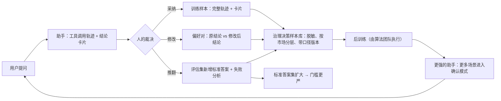

# PRD：治理策略巡检与异常归因助手（v3.0）

Oct 16, 2026 · Dekun Sun · 最后更新 Oct 21, 2026 · 文中的策略、市场、公会、数字均为合成数据；凡写 xxx / xx 的是上线前按真实基线确定的值，带"原型"字样的数字来自合成世界。

研发视角的实现与评测细节见附件 [technical-one-pager.md](technical-one-pager.md)；后训练过程与全部数字见 [../reports/posttrain_report.md](../reports/posttrain_report.md)。

## 版本记录

| 日期 | 版本 | 变更 |
|---|---|---|
| 2026-10-16 | v0.1 | 背景、用户、核心场景、架构 |
| 2026-10-17 | v0.2 | 公会维度、流程图、数据飞轮 |
| 2026-10-18 | v0.3–v0.4 | 资金侧处置、公会健康分；原型与模拟数据；指标口径、上线计划、不做清单；后训练结果 |
| 2026-10-19 | v0.5 / 精简版 v2.1 | 产品流程图、对话示例、状态图；三个方案供决策；业务侧数字改为占位 |
| 2026-10-21 | v3.0 | 长版与精简版合并为一份；问题改按任务结构写；原型验证单独成章；技术细节移到附件 |

## 0. 一页摘要

**提议**：在直播治理平台之上加一个只读的会话式助手。策略 owner 一句话提问，助手按 playbook 调用平台工具查证据，给出带证据编号的结论卡片；人确认、修改或推翻，每一次确认都变成训练样本。助手不直接改任何策略：策略修改只生成草稿走审批，资金类动作只标注"需要财务审批"。

**目标是三件事**：

1. 把一次归因的时间从 xxx 分钟缩到 xx 分钟内，并且每个结论都带证据编号、能回到平台核对。
2. 把巡检和 policy 落地产品化：问题由系统定时发现并推送，policy 更新落成可回测的变更草稿。
3. 把每一次人工裁决变成训练自有模型的数据。

**北极星指标**是每周经人确认的治理决策数；**护栏**是采纳率 ≥ xx%、推翻率 ≤ xx%、幻觉 0、误处罚不劣于上线前。

**现状**：原型已在合成世界上跑通整条链路——规则引擎在标准答案题上全对、幻觉 0；一个 4B 开源模型经微调后，归因题 94%–96%、策略调整题 91%–98%（原型，合成数据）。真实数据上的验证是上线前的门槛（第 5 节）。

**请决定的事**：三个方案选一个，以及由哪个团队试点。

| | 方案 A：最简 | 方案 B：推荐 | 方案 C：最完整 |
|---|---|---|---|
| 做什么 | 规则引擎按 playbook 自动归因，输出带证据编号的结论卡片；人确认 / 推翻；只读 | A + 开源小模型按规则引擎示范做微调，接自然语言提问；评估集与评分器；巡检推送；policy → 变更草稿（审批） | B + 用确认后的结论持续训练自有模型；多团队 playbook 平台化；内部模型路由…… |
| 不做什么 | 不接模型，问法固定；不做巡检和草稿 | 不做自有模型的持续训练；不做多团队 | — |
| 能拿到什么 | 归因从 xxx 分钟降到分钟级，结论可追溯；规则引擎已在原型里验证 | 自然语言提问、新问法可泛化；每次确认都变成训练样本 | 能力随使用持续提升；策略团队自己写 playbook |
| 依赖 | 平台只读接口 | A 的依赖 + 一张 GPU（原型实测一次训练约 1 小时）+ 试点团队做并行对照 + 外部验证集 | B 的依赖 + 算法团队承接训练 + 审批流对接 |
| 周期（粗估） | 几周内接入试点 | 一个季度量级到封闭 Alpha | 半年以上 |
| 主要风险 | 问法和场景一多就要不停写规则 | 真实准确率要靠外部验证；用户信任 | 口径对齐、跨团队分工、训练样本偏差 |
| 适合 | 先验证"有没有人用"，投入最少 | 想把这件事做成产品并沉淀数据 | 已经决定把治理平台 Agent 化作为年度目标 |

下文按方案 B 写；A 是 B 的第一步，C 是 B 的延伸。

## 1. 问题

直播治理平台通常已经有策略库、指标、变更记录、申诉和抽检样本这几类能力。策略 owner 日常要回答的几类问题，共同点是答案不在任何一张表里，要把几类数据对起来看：

| 要回答的问题 | 要对起来看的数据 | 难在哪 |
|---|---|---|
| "某市场某场景的处罚为什么涨了" | 流量、策略命中、同期变更（模型、策略、policy）、申诉推翻、抽检精确率 | 同一个症状有好几种原因（流量涨了、模型分漂移、策略改了、新策略上线、某个公会集中违规），每种对应不同动作；先后顺序影响结论，不先排除流量就容易把正常波动当事故 |
| "这条策略还健不健康" | 命中趋势、精确率、申诉推翻率、与其他策略的重叠、模型分分布 | 没有单一指标能回答；问题往往在出事后才被注意到 |
| "这条 policy 更新怎么落成策略修改" | policy 文本、目标策略、一组候选分数线的回放结果 | 覆盖率、精确率、人审量三个约束要同时满足，并且回放窗口上调出来的线不一定能过未来的数据 |
| "某公会的健康分为什么掉了" | 旗下主播的处罚与申诉、对应策略的误判情况 | 要分清真实违规和策略误杀造成的不合理扣分，后者该暂缓处置并回补 |

这四类问题有三个共性：**步骤多且有分支**，每一步的发现决定下一步查什么；**口径陷阱多**，流量、分母、小市场样本量都会误导；**每一次判断都是一条有价值的记录**，但以对话或工单的形式存在时，既不能复用，也不能用来训练模型。

## 2. 为什么现在能做

三个条件同时满足：

1. **平台已经有数据和工具**，缺的只是把"查、下钻、对照、下结论"这条路自动走一遍。
2. **这类问题有标准做法**：先排除流量 → 看增量集中在哪 → 查同期变更 → 看是误判还是漏判。这套做法可以写成 playbook，既是给人看的文档，也可以直接作为模型的 system prompt。
3. **有确定性的标准答案**：主因只有十来类，编号要么存在要么不存在，该不该升级有规则。评分可以是确定性的，于是能自动评测、能把评分当强化学习的奖励、能用规则引擎批量产生示范。原型用这个性质走完了"出题 → 评分 → 训练 → 评测"的全链路（第 7 节）。

这也是它和通用对话助手的分界线。公开资料里，电商平台的卖家助手已经从问答工具升级为"回答 → 推理 → 规划 → 经许可执行"的 agentic AI，本方案共享同样的原则：接在成熟平台之上、用实时数据而不是文档、代为执行要经许可、转人工带完整记录。差别在三点，决定了本文把重点放在评分器、门控和审批上，而不是对话体验：

| | 卖家助手 | 治理助手 |
|---|---|---|
| 单次任务深度 | 多数是"一个条件判断 + 一个动作" | 一次归因十来步工具调用，中间有分支，错一步后面全偏 |
| 对错有没有标准答案 | 多数没有，靠用户满意度 | 有：规则引擎和回放窗口给确定性评分，能自动评测、能后训练 |
| 错误后果 | 单店、单订单、可撤销 | 改一条策略影响整个市场的处置，可能带资金冻结；只提方案，分级审批 |

## 3. 方案：一个只读的助手，六步

1. **提问**：策略 owner 一句话提问（"某市场昨天误杀申诉涨了？"）。
2. **查证据**：助手按 playbook 调用平台的只读工具——查数、下钻、查变更、看漂移——每个结果都带证据编号；调用次数有上限。
3. **结论卡片**：主因、证据编号、是否升级、建议动作。卡片里引用的每个策略 / 变更 / 公会编号都必须真实存在、而且是助手这次查到过的；凭空写出来的编号会被校验层拦下，结论退回重做。小市场、头部主播、资金侧的升级规则写死在护栏里。
4. **人工决策**：确认、修改后确认、或推翻并写原因；决策记录可追溯。
5. **沉淀样本**：只有经人确认的结论进入训练样本池。
6. **不直接改任何策略**：策略修改只生成变更草稿（回放结果 + 建议分数线）走审批流，通过后才生效；资金类动作只标注"需要财务审批"，不生成执行指令。

同一流程的一次完整对话示例（合成数据；①–⑥ 对应上面六步；[动画版](media/assistant-flow.mp4)）：

### 归因 playbook（原型版）

1. 确认口径：分母、指标版本；有歧义则选定并写明。
2. 分解变化：流量变化 × 违规率变化 × 策略命中率变化；流量能解释的，到此为止。
3. 下钻：市场 → 场景 → 策略 → 公会，找贡献最大的部分。
4. 查同期变更：策略版本、模型升级、policy 更新、特征下线。
5. 判断类型：模型升级 + 分数上移 → 模型漂移、固定阈值失效；策略版本 / 新上线 → 预期内变更；命中降、举报不降 → 对抗绕过、召回下降；无变更、增量集中在单一公会 → 公会级问题；都不是 → 低置信度，升级。
6. 抽样若干 case 作为证据；输出结论 + 置信度 + 证据编号 + 下一步。

巡检是同一套检查的定时版：效果下降、长期不命中、互相重叠、模型分漂移导致阈值失效；已暂停的策略和预期内的变化标为提示，不当作告警。

### 本期范围

| 优先级 | 事项 | 为什么是这一期 |
|---|---|---|
| P0 | 异常归因：一句话提问 → 带证据的结论卡片 → 人确认 / 修改 / 推翻 | 频次最高、步骤最标准、有确定性标准答案 |
| P0 | 评估集与评分器：标准答案题、确定性评分，每次发版跑回归 | 没有评测就没有发版依据，也没有后训练的奖励 |
| P0 | 公会健康分归因 | 和异常归因共用工具与评分器，只多一条 playbook |
| P1 | 策略健康巡检：定时扫描 → 推送 | 复用归因的工具和评分器，增量小 |
| P1 | Policy-to-Strategy：policy 文本 → 可回测的变更草稿（仍需审批） | 价值高但风险高，所以放在"只出草稿"的边界内 |
| P2 | 用确认后的结论做后训练 | 依赖前面的样本积累；原型已验证技术路径 |

上线范围：一个策略团队，先 x 个大市场；小市场只读且样本不足时强制升级。

### 典型场景

- **异常归因**："某市场赌博场景这周误判率上升了。"先查流量排除流量驱动 → 按策略下钻 → 查同期变更 → 检查模型分数漂移 → "主因：模型升级后分数漂移，S-xxx 固定阈值失效；建议：评估阈值重校；不需要升级"。用户把建议分数线微调后确认。
- **没有异常 / 数据不足**：正常波动答"属正常波动，未发现异常"；小市场样本不足答"数据不足，建议扩大窗口或人工复核"。这两类在原型测试集里约占三分之一，是误报控制的关键。
- **公会健康分归因**：区分旗下主播的真实违规和策略误杀造成的不合理扣分；后者建议暂缓档位处置、重校后回补。
- **巡检发现并推送**：某条策略连续多日命中为 0，或两条策略命中高度重叠，推送给 owner，附证据与建议动作。
- **policy 更新落地**："某场景人审量不超过每天 xx 场，覆盖率不低于 xx%，精确率不低于 xx%"。找到对应的转人审策略，回放一组分数线，给出满足约束且留有余量的线，生成变更单草稿，标注是否涉及资金侧审批。

## 4. 边界

助手的错误后果是改错一条影响整个市场的策略，所以边界靠代码，不靠模型自觉。

| 情形 | 助手的行为 | 实现位置 |
|---|---|---|
| 写权限 | 没有写工具；唯一的"写"是生成草稿；草稿必须经审批流；资金类动作不生成草稿 | 工具层 |
| 幻觉 | 引用的编号必须真实存在且本轮查到过；否则拒收并列出已见编号 | 校验层 |
| 何时澄清 | 缺市场或日期；问题同时指向多个策略而无法判断 | 范围解析 |
| 何时调用工具 | 按 playbook 顺序；"处罚涨了"类问题没查流量不允许提交 | 提交门控 |
| 何时说"不知道" | 小市场样本不足、数据窗口不全、数据矛盾 | 评分器把"数据不足"当正确答案 |
| 何时拒绝 | policy 条文解释、单个主播 / 公会的处置建议、治理分类法之外的问题 | 默认回答 |
| 何时转人工 | 资金侧、头部主播、处罚量变化超阈值、样本不足、同类结论连续被推翻、用户明确要求复核；升级时把完整轨迹和证据交给接手人 | 护栏，不交给模型 |
| 变更草稿的分级 | 低风险一人确认；中风险策略 + 运营双确认；高风险（大范围处罚、头部主播、新增处罚类型）只出建议 | 审批流 |
| 失败恢复 | 工具调用失败重试一次，仍失败则报告缺什么，不编造；数据缺失或矛盾时停下并说明，给出可验证的部分 | Harness |
| 可观测 | 每次运行留完整轨迹写入审计日志；playbook 和策略有版本号；总开关、按 playbook 开关、单次影响面上限 | 平台 |

**不做的事**：不做内容检测模型；不直接执行策略修改和资金动作；不对单个主播、单个公会做处置建议；不替代 policy 条文解释；证据不足不给结论；不替代现有平台界面，用户随时可以切回。责任归属：批准的人对决定负责，平台对助手质量负责。

## 5. 度量

原则：考核业务产出，不考核输入。对话次数、调用次数这类输入指标只用于排查问题，不作为目标。

| 类别 | 指标 | 口径 | 目标 / 基线 |
|---|---|---|---|
| 用户 | 经人确认的治理决策数（北极星） | 每周确认 + 修改后确认的卡片数；只计"确认"，不计"查看" | 持续上升；若推翻率同步上升说明在走过场 |
| 用户 | 采纳率 / 推翻率 | 确认（含修改后确认）÷ 卡片数；推翻 ÷ 卡片数 | ≥ xx% / ≤ xx% |
| 业务 | 异常定位时长 | 从提问到 owner 确认结论，中位数 | xxx 分钟 → xx 分钟内 |
| 业务 | 策略迭代周期 | 异常确认到修改上线的中位天数 | 缩短 |
| 业务 | 误处罚水平 | 头部主播误处罚数、资金侧误杀金额、机构不合理扣分回补率 | 不劣于上线前 |
| 质量 | 标准答案集通过率 | 8 项标准全对的题数 ÷ 题数，每次发版回归 | ≥ xx%（原型在合成数据上 94%–96%） |
| 质量 | 幻觉率 | 引用了不存在或本轮未查到的编号 | 0 |
| 质量 | 升级正确率 | 该升级的升级、不该的不升级 | 按市场分层看，任一市场不明显落后于整体 |

**评估方案**：先看失败模式，再看平均准确率。标准答案集从历史工单和已结案的异常中整理 xx 个已知原因的场景，覆盖不同市场和常见陷阱；评分器按 8 项确定性标准打分，全对才算通过；每个错误归类到"工具缺失 / playbook 不全 / 口径 / 需要训练"，修复后跑回归，确认没有改坏别的场景；被推翻的题进入标准答案集。

**真实基线**：上线前和试点团队一起采集四个数，作为对照写进本节——人工归因时长（连续 x 周记录每次从提问到结论的时间，取中位数）、人工结论被推翻率（同期复盘）、策略迭代周期（近 x 个月的中位天数）、误处罚水平（治理质量报表的月均值）。没有基线的目标不算目标。原型的数字全部来自合成世界，衡量的是"与规则引擎一致"；上线前还要用一批真实题做外部验证（模板见 [external-validation-template.md](external-validation-template.md)）。

## 6. 上线与采纳

| 阶段 | 范围 | 目标 | 退出条件 |
|---|---|---|---|
| 内测 | 产品 + x 位策略同学 | 标准答案集跑通，收集阻塞问题 | 标准答案集 ≥ xx%，幻觉 0 |
| 封闭 Alpha | 试点团队 x 人，归因只读，与人工并行 | 对比助手结论与人工结论 | 采纳率 ≥ xx%，推翻 ≤ xx%，没有未归类的失败 |
| 开放 Alpha | 同团队全体，开巡检推送 | 渗透率与巡检误报 | 任一市场准确率不明显落后于整体；巡检误报可接受、重大问题不漏 |
| Beta | 第二个团队，开变更草稿（审批） | 复现 Alpha 结果 | 第二团队重复 Alpha 门槛；草稿返工率下降 |
| GA | 全部策略团队 | …… | …… |

**采纳机制**：三档模式——建议模式（助手给结论，人来做）→ 确认模式（助手准备好，人点确认）→ 低风险场景自动执行，每个流程、每个风险等级单独升档；初期助手与人工同时做归因，用对比数据说服更多人放手；每个 playbook 配一页说明（能做什么、不能做什么、什么时候必须人工确认）；playbook 主干统一，市场差异用配置，小市场默认更保守的权限。

**依赖**：指标口径的 owner（平台只做承载）；指标、变更日志、抽检的只读接口；外部验证集与真实基线（上线前门槛）；审批流对接（Beta 前）；数据权限与保留期限走现有流程。

## 7. 数据飞轮

做对话式助手不只是为了多一个工具，而是为了拿到通用模型拿不到的东西：治理领域的决策数据。"哪些波动该忽略、哪些该升级、哪个口径是陷阱、小市场该多保守"这些判断，只能从自己的决策记录里学。助手是采集和校验这些数据的入口。

需要提前对齐的事：只采集经人确认的结论，避免把助手的错误当成标签；按市场分层，防止大市场样本淹没小市场；修改类样本偏向"被质疑的结论"，随机抽一部分被采纳的结论复核作为无偏校准集；数据权限和保留期限走现有流程。策略团队的裁决就是标注本身，不额外增加标注工作。

## 8. 原型验证：做了什么、学到了什么

为了验证"决策数据 → 更好的模型"这条路技术上走得通，原型搭了一个合成的治理平台（28 天、6 个市场、8 类风险、29 条策略、51 家公会），埋入 11 类已知答案的问题，然后把整条链路跑了一遍：自动出题 → 规则引擎解题作为示范 → 微调一个开源小模型 → 用同一个评分器评测。每一步只改一件事：

| 步骤 | 改了什么 | 归因通过率（194 题） | 策略调整通过率（150 题） | 学到什么 |
|---|---|---|---|---|
| 规则引擎（参考） | — | 标准答案题全对 | — | 幻觉 0；作为教师和参考答案 |
| 4B 不训练 | — | 3.6% | 16% | 不是题难，是不会这套打法 |
| 一轮监督微调 | 规则引擎示范 374 条 | 79%–85%（3 种子） | 53%–63% | 示范里的"想法"必须由证据生成，不能是模板 |
| 补稀有类示范 | 示范 374 → 831 条 | 92%–94%（2 种子） | 69% | 召回下降类 0/11 → 11/11；先看错在哪类、补那类 |
| 换 8B，同样数据 | 只换模型 | 96% | 70% | 只比 4B 多对 4 题；数据质量比模型大小值钱 |
| 改策略调整示范的"想法" + 2 个 epoch | 示范写出约束、候选分数线和选择规则 | **94%–96%（2 种子）** | **91%–98%** | **当前可用版本**（4B） |
| 强化学习（GRPO）× 3 种子 | 在 SFT 之上 | +4 / +1 / 0 题（噪声内） | +3 / +7 / +17 题 | 收益远小于改示范；RL 放最后一步 |

三条对产品的含义：

1. **顺序是先修交互层、再补示范、最后才是强化学习**，三者的性价比差一个数量级。交互层的问题（参数格式、重复报错、编号校验）几行代码就能修，占未训练模型失败的大头；示范数据的每一次改动都带来十个点以上的提升；RL 在此之上只有一两个点。
2. **小模型够用**：4B 和 8B 训练后只差几题；数据质量比模型大小值钱。
3. **单次运行有波动**：归因在不同随机种子下相差约 ±8 题，主要来自只有 16 题的"误判率上升"类。所以门槛按多种子中位数定，小于 10 题的差异不当结论。

这些结果说明链路是通的、便宜的（一次训练约 1 小时、不到 1 美元）；不说明真实准确率——题目、答案、示范都来自同一个规则引擎。真正的瓶颈是真实数据和真实标注，这是第 5 节外部验证的由来。技术细节（评测集构建、评分器、训练配置、多种子结果）见附件。

## 9. 风险与开放问题

| 风险 | 影响 | 应对 |
|---|---|---|
| 用户不信任助手结论 | 采纳率低 | 并行对照、证据可见、随时切回平台 |
| 市场差异大、小市场数据少 | 归因错误集中在小市场 | 按市场评估，样本不足时强制升级 |
| 复杂场景助手不好用 | 结论不稳定 | 从标准化程度最高的流程切入，复杂场景保留人工 |
| 训练样本有偏 | 后训练学到偏差 | 随机抽一部分被采纳的结论复核，作为无偏校准集 |
| 合成数据上的数字不代表真实准确率 | 门槛定错 | 外部验证集作为上线前门槛；门槛按多种子中位数定 |
| 部分能力尚无接口 | 助手无工具可用 | 补公共数据服务，纳入平台基建优先级 |

开放问题：由哪个团队试点、哪类问题最先接；指标口径由谁认定；助手参与的治理决策，人工审批边界由谁定；训练和 playbook 编写的分工；外部验证集由谁标注、何时能有。

## 附录 A：交互流程

入口：平台常驻入口，打开后显示本周巡检发现和按当前页面推荐的冷启动问题；开场语说明"只读平台数据，结论都带证据编号，修改策略需要你确认"。调用过程以折叠行展示，可随时展开；卡片上的数值和主因可直接改，修改记录原值；会话长时间无交互自动结束并请求反馈。

| 状态 | 进入条件 | 助手做什么 | 用户能做什么 | 下一状态 |
|---|---|---|---|---|
| S0 开场 | 打开入口 | 显示巡检发现和冷启动问题 | 选一个问题，或自己输入 | S1 |
| S1 范围解析 | 收到问题 | 解析市场 / 场景 / 日期；齐全则进入 S2 | — | S2 或 S1a |
| S1a 澄清 | 缺市场或日期 | 只问缺的字段，不查数 | 补充信息 | S1 |
| S2 查证据 | 范围齐全 | 按 playbook 调用只读工具 | 展开任一步看证据；随时追问 | S3 |
| S3 提交门控 | 助手准备提交 | 检查主因在枚举内、查过流量、编号都在本轮出现过；不通过则退回 S2 | — | S4 |
| S4 结论卡片 | 门控通过 | 展示主因、证据编号、是否升级、建议 | 确认 / 修改后确认 / 推翻（选原因）/ 追问 | S5、S2 或 S6 |
| S5 决策记录 | 用户点了确认或推翻 | 写入决策记录和样本池；若生成了草稿则提交审批 | 继续提问或结束 | S1 或 S7 |
| S6 升级 | 命中升级规则或用户要求复核 | 把完整轨迹、证据和结论交给接手人 | 等接手人处理 | S7 |
| S7 结束 | 用户结束或长时间无交互 | 请求反馈 | 反馈 | 回到 S0 |

多轮追问共享上下文；追问进入策略调整分支时，输出是变更草稿而不是归因卡片，按钮从"确认"变为"提交审批"。三轮对话的分步截图：

## 附录 B：功能需求（P0）

| # | 功能 | 触发条件 | 系统行为 | 输出 | 验收标准 |
|---|---|---|---|---|---|
| F1 | 异常归因 | 用户提出"处罚 / 命中 / 误判变化"类问题 | 按 playbook 调用只读工具；先查流量；编号校验；命中升级规则时标记 | 结论卡片：主因（枚举）、编号、是否升级、一句话结论、建议 | 标准答案集 ≥ xx%；幻觉 0 |
| F2 | 范围澄清 | 问题缺市场或日期 | 不查数，先反问缺失字段 | 澄清问题 | "需要澄清"类题 100% 先澄清 |
| F3 | 没有异常 / 数据不足 | 波动在正常范围，或样本低于阈值 | 对照近期中位数；小市场按样本阈值 | "属正常波动"或"数据不足" | 误报率可接受 |
| F4 | 调用过程可见 | 每次工具调用 | 折叠行展示调用与返回（带证据编号） | 可展开的轨迹 | 每张卡片都能回溯到证据 |
| F5 | 人工修改 / 确认 / 推翻 | 用户操作卡片 | 修改记录原值与新值；推翻必须选原因；都写入决策记录与样本池 | 决策记录 | 推翻必须带原因 |
| F6 | 升级 | 命中护栏规则 | 卡片顶部标"需要人工复核"，把完整轨迹和证据交给接手人 | 升级记录 | 升级正确率按市场看 |
| F7 | 公会健康分归因 | 用户问某公会分数变化 | 按公会下钻，区分真实违规与策略误杀 | 结论卡片 + 是否建议暂缓处置 | 同 F1 |

P1 的巡检与变更草稿、文案、埋点……实现时再细化。

## 附录 C：原型

可运行原型、模拟策略库与模拟数据的白话说明、演示页：见仓库根目录 README，以及 [simulated-strategy-library.md](simulated-strategy-library.md)、[simulated-data.md](simulated-data.md)、[../demo/](../demo/)。研发视角的实现、评测与训练细节：[technical-one-pager.md](technical-one-pager.md)。
