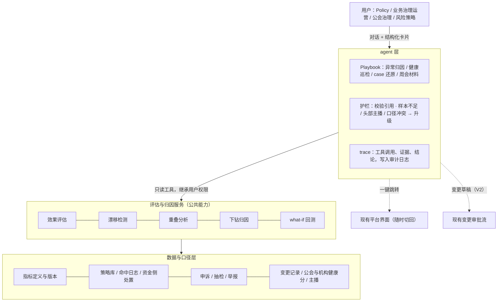
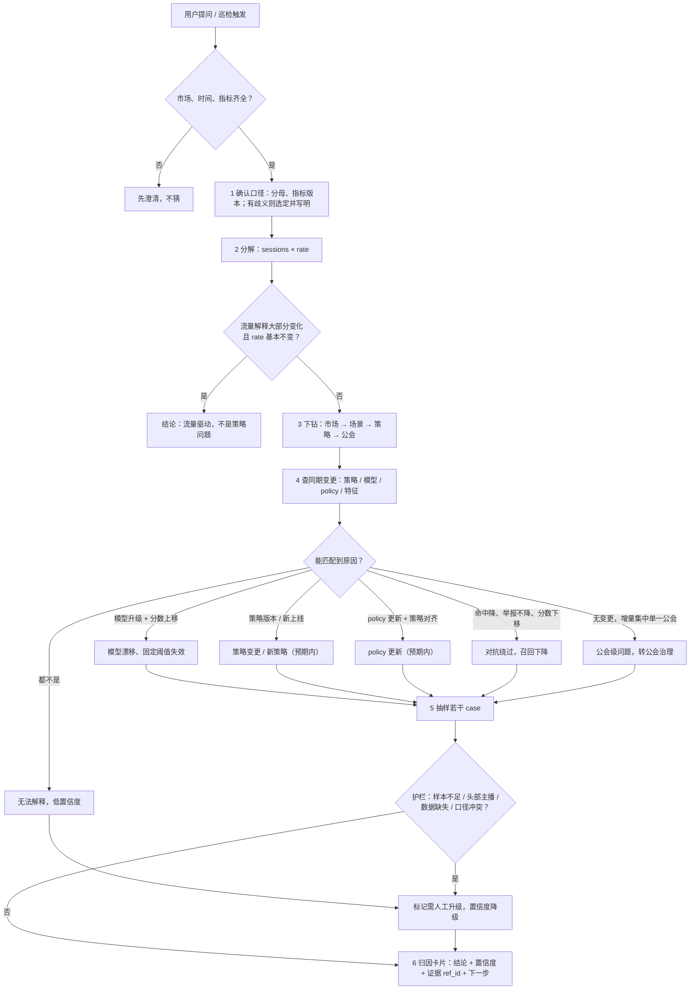
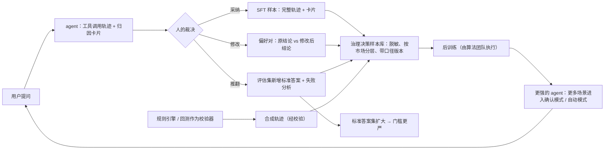

# PRD：治理策略巡检与异常归因助手（假设版）

Oct 16, 2026 · Dekun Sun · 最后更新 Oct 20, 2026

## 版本记录

| 日期 | 版本 | 变更 |
|---|---|---|
| 2026-10-16 | v0.1 | 初版：背景、目标、场景、架构、playbook、评估与上线门槛、指标 |
| 2026-10-17 | v0.2 | 用户改为 policy / 业务治理运营 / 公会治理 / 风险策略；加公会维度、流程图、数据飞轮 |
| 2026-10-18 | v0.3 | 加资金侧处置与公会健康分；原型与模拟数据说明；交互设计加流程图与动画 |
| 2026-10-18 | v0.4 | 加"与通用型助手的对照"、指标口径、上线计划与不做清单；更新后训练实验进展 |
| 2026-10-19 | v0.4.1 | 后训练进展更新：补稀有类示范后 4B 92%–94%、8B 96%，GRPO 第二版小幅正向（多种子验证中） |
| 2026-10-20 | v0.5 | 业务侧数字改为 xxx 占位、原型数字加标注；示意里的策略编号与具体数值虚化；上线计划改为阶段制 |

## 文档说明

这是一份外部视角的假设版 PRD：为一个成熟的直播治理平台设计一个对话式助手，让策略和运营团队用对话完成“策略巡检”和“异常归因”这两类高频工作，而不必手动操作平台。

- 信息来源：直播平台治理相关的公开招聘信息（治理策略、模型策略运营、治理 DS、规模化运营、T&S 等岗位），以及对团队方向的公开性描述。
- 未使用任何内部数据。文中的工具名、流程都是假设；**数字的约定**：凡写 xxx / xx 的地方是需要使用方用真实数据填的值，原型阶段填不了；带"原型"字样的数字来自合成世界，只说明技术上可行，不代表真实业务；市场、场景、策略编号都是示例。与主线无关的细节用"……"略过，实现时再定。
- 定位：平台产品负责“怎么做”（能力、边界、质量），策略团队继续负责“做什么”和最终决定。

> 对应的可运行原型见本仓库根目录 README；原型里的策略编号、市场、数字全部是合成的。模拟的策略库和数据各有一份白话说明：[模拟策略库说明](simulated-strategy-library.md)、[模拟数据说明](simulated-data.md)。

## 背景与问题

治理平台的核心能力已经成熟、业务已 SOP 化，但策略和运营团队仍在大量手动操作平台；下一步是把其中“固定性问题”交给 agent。

**问题 1：策略工作重、链路长。** 治理策略的生命周期是：发现风险 → 构建策略（规则、阈值、风险分）→ 回测上线 → 监控 → 评估 precision/recall → 迭代或下线。它和金融授信、反欺诈类似：有对抗性、错误代价不对称、多层策略叠加，人工上策略、看效果的成本很高。

**问题 2：多个团队重复做同一件事。** 从公开岗位看，模型策略运营、治理 DS、安全项目经理、策略产品都在评估线上策略、监控指标、做根因分析。各自取数、各自定口径，开会先对数。

**问题 3：全球化放大了复杂度。** 一套标准要治理所有市场，同一个指标波动在不同市场原因不同，小市场数据稀疏，归因容易误判。

**为什么现在做：** 核心平台已经把业务标准化，具备 agent 化的前提；而“可信的评估与归因”又是未来让平台自动迭代策略的地基——没有它，就无法判断策略改得好还是坏。

## 目标与非目标

MVP 只做只读类工作（巡检、归因、证据包），不自动发布策略，用低风险场景先建立信任。

### 目标

1. 释放策略和运营团队在“指标异常归因”和“线上策略健康巡检”上的人力。
2. 统一策略评估口径，让各团队用同一套数和方法讨论问题。
3. 把评估与归因做成可复用的平台能力，为后续“策略迭代智能化”打基础。
4. 治理质量不变差：所有自动化都有护栏指标和人工兜底。

### 非目标

- 不做内容检测、模型训练、打标、大模型模拟人审。
- 不替策略团队写策略、做决定。
- MVP 不自动上线任何策略变更；写操作放在后续阶段。
- 不替代现有平台界面，用户随时可以切回平台。

## 用户与核心场景

主要用户是 policy 团队、业务治理运营、公会治理和风险策略团队；地区运营通过收口方间接使用。

| 用户 | 今天的痛点（假设） | 最需要的能力 |
|---|---|---|
| Policy 团队 | 政策更新后要确认线上策略是否对齐、处罚是否符合标准，靠人工抽 case | 政策更新后的策略对齐检查、case 证据包 |
| 业务治理运营 | 每天看大盘、下钻、拉 case，定位问题耗时；每周写归因和周报 | 异常归因、周会材料 |
| 公会治理 | 公会 / 主播维度的处罚和申诉波动，头部公会的问题要快速定位和解释 | 按公会、主播下钻的归因，case 证据包 |
| 风险策略 | 构建和迭代策略、定期人工评估线上效果、模型升级后重校阈值 | 策略健康巡检、模型分漂移提醒、回测与变更草稿 |

### 核心场景

1. **异常归因（MVP）**：“某区域昨天误杀申诉涨了，帮我看看”。agent 下钻到区域、场景、策略、公会，排除流量变化等干扰，给出带证据的结论。
2. **策略健康巡检（MVP）**：定时扫描所有线上策略，输出待处理清单：效果下降、长期不命中、互相重叠、模型分漂移导致阈值失效。已暂停的策略不命中是预期结果，单独列为提示，不当作僵尸策略报警；同理，policy 更新、新策略上线带来的变化标为预期内。
3. **Case 还原证据包（MVP）**：输入一个 case，还原命中了哪些策略、模型分、处罚链路、是否涉及资金侧处置。
4. **机构健康分归因（MVP）**：“某公会健康分为什么掉了”。区分旗下主播的真实违规和策略误杀造成的不合理扣分，后者要先暂缓档位处置、重校后回补分数。
5. **周会材料（V1）**：汇总一周的异常、归因和行动项。
6. **阈值重校建议（V2）**：模型升级后，提出受影响策略的新阈值并回测，生成变更单草稿供人审批。

## 机会评估方法

先用 xx 周实地观察拿到真实人时，再算 ROI；没有基线前不承诺数字。

**估算公式**

每周可释放人时 = Σ(流程) 频次 × 单次耗时 × 参与人数 × 自动化比例

**场景选择标准（每项 1–5 分）**

| 维度 | 说明 |
|---|---|
| 频次 × 耗时 | 做得越多、越耗人，收益越高 |
| SOP 清晰度 | 步骤和判断标准是否明确 |
| 输入是否都在平台内 | 数据不在平台里，agent 也拿不到 |
| 结果可校验 | 归因可用数据验证，策略可回测 |
| 出错代价与可逆性 | 决定人工介入放在哪里 |
| 是否历史绕路 | 是则先重设计 SOP，而不是照搬 |

异常归因和健康巡检在“频次高、只读、可校验”三项上都得分高，所以作为 MVP。

重新设计而非照搬的例子：若现有 SOP 是“导出数据 → 手工汇总 → 写周报”，不让 agent 模仿导表，而是先补一个公共数据服务，让 agent 和其他团队都能直接调用。

## 产品方案

核心原则：agent 不新建能力，只编排平台已有的确定性能力；所有结论必须引用证据，所有写操作走现有审批流。

### 架构

agent 层按团队提供不同 playbook，底下复用同一套评估与归因服务；如果这些能力平台已有，agent 层直接接在上面。

### Playbook 示例：异常归因

Playbook 是把 SOP 写成 agent 可执行的流程，由平台和策略团队共同编写。

- 触发：用户提问，或巡检发现指标超出正常波动范围
- 输入：指标名、市场、时间窗；缺少时先澄清，不猜
- 步骤
  1. 确认口径：用哪个分母、哪个版本的指标定义
  2. 分解变化：流量变化 / 违规率变化 / 策略命中率变化
  3. 下钻：市场 → 场景 → 策略，找贡献最大的部分
  4. 查变更：同期是否有策略上线、模型升级、policy 更新
  5. 抽样：拉若干典型 case 作为证据
  6. 输出归因：结论 + 置信度 + 证据 + 建议下一步
- 停止与升级条件：数据缺失或口径冲突；样本量低于门槛（小市场）；结论涉及头部主播或新型违规
- 输出：结构化归因卡片，可一键跳转平台对应页面

### 工具与权限

agent 以发起对话的用户身份行事，继承其平台权限，不是超级账号。

| 工具（假设） | 读/写 | 作用 | 权限 |
|---|---|---|---|
| query_metrics | 读 | 按维度查治理指标 | 继承用户 |
| get_strategy_config | 读 | 读策略条件、阈值、动作、版本 | 继承用户 |
| get_hit_logs | 读 | 拉策略命中和处置记录 | 继承用户 |
| sample_cases | 读 | 抽样典型 case | 继承用户 |
| get_change_log | 读 | 策略、模型、policy 变更记录 | 继承用户 |
| score_drift | 读 | 模型分分布漂移检测 | 继承用户 |
| run_backtest | 读 | 回放历史数据估算效果 | 继承用户 |
| get_guild_health | 读 | 机构健康分逐日分数、档位、扣分来源 | 继承用户 |
| draft_change | 写（V2） | 生成变更单草稿 | 走审批流，不自动提交 |

### 交互设计

- 对话 + 结构化卡片：结论、证据、图表、策略改动前后对比、确认按钮
- 意图澄清：问题模糊时先问市场、时间、口径
- 推理可见：展示查了什么、依据是什么
- 随时接管：一键跳到平台页面，带上已筛好的条件
- 主动推送：巡检发现异常时推送到策略 owner

示意对话：

> 用户：某市场昨天误杀申诉涨了，帮我看看。
> 助手：申诉推翻数环比上升，其中大部分来自策略 S-xxx。同期模型于前天升级，该策略使用的模型分中位数上移，固定阈值导致命中增加。附若干抽样 case。建议：请策略 owner 评估阈值重校。[查看证据] [在平台打开]

（示意中的策略编号和现象均为虚构。）

多轮对话的完整流程（原型在合成数据上的运行结果，数字均为合成；[动画版](media/assistant-flow.mp4)）：

**第 1 轮：归因。** 助手按 playbook 查数、下钻、查变更、抽 case，给出结论卡片；涉及头部主播，标为需要人确认。

**第 2 轮：人修改。** 助手回放不同分数线后给出建议；策略 owner 认为召回代价太大，改成更宽松的一档。修改前后的两个版本记为一条偏好样本。

**第 3 轮：资金侧影响与确认。** 助手说明冻结收益的影响有限，只有已推翻的少数场次需要复核解冻；owner 确认，草稿进入审批流，整条对话记入决策样本。

### 人工介入与升级

- 只读结论：不需审批，但默认显示置信度和证据
- 变更草稿（V2）：按影响面和可逆性分级——低风险一人确认；中风险策略 + 运营双确认；高风险（大范围处罚、头部主播、新增处罚类型）只出建议
- 强制升级：口径冲突、policy 解释有歧义、样本不足、置信度低
- 责任归属：批准的人对决定负责，平台对 agent 质量负责

### 处置动作梯度与资金侧处置

直播治理和短视频的关键差别是处置可以落到钱上。原型里的动作梯度（严重度递增）：

| 动作 | 严重度 | 可逆性 | 备注 |
|---|---|---|---|
| observe 观察 / manual_review 转人审 | 0–1 | 完全可逆 | 不算处罚 |
| limit_traffic 限流 / warn 警告 | 2–3 | 可逆 | |
| delay_settlement 延迟结算 | 4 | 可逆，但影响主播现金流 | 资金侧 |
| freeze_earnings 冻结违规场次收益 | 5 | 误杀需解冻，有争议成本 | 资金侧 |
| suspend_live 断播 | 6 | 场次不可逆 | |
| disable_gifts 关闭礼物 | 7 | 持续影响收入 | 资金侧 |
| ban_7d 封禁 | 8 | 最高 | |

资金侧动作对 agent 的要求：结论涉及资金侧策略时必须给出冻结金额（`frozen_amount`），下一步要写明“误杀场次复核后解冻”，变更草稿一律需要结算/财务知会；模型漂移影响的策略里若有资金侧动作，优先级高于同模型的下播策略。

### 机构（公会）健康分

公会侧治理的核心抽象是机构健康分：旗下主播的严重处置超过市场基准时扣分，分数越档触发约谈、暂停结算、扣收益、清退（示例档位 80/70/60/50）。它把策略质量和公会治理连在一起：策略误杀会变成对公会的不合理扣分。所以“某公会健康分为什么掉了”要分两种答案——旗下主播真实违规（转公会治理按档位处置），或扣分来源策略正受模型漂移影响（暂缓处置、重校后回补）。巡检里公会越档是一类发现，处置前先看扣分来源。

### 失败恢复

- 工具调用失败：重试一次，仍失败则报告缺什么，不编造
- 数据缺失或矛盾：停下并说明，给出可验证的部分
- 用户否定结论：记录为反馈样本，进入每周复盘

### 可观测与可控

- 每次运行留完整 trace（调用了哪些工具、看了哪些证据、为什么得出结论），写入平台审计日志
- playbook 和策略都有版本号
- 总开关、按 playbook 开关、单次影响面上限

## 原型：模拟策略库与数据

为了在拿到真实数据前验证方案，原型搭了一个合成的治理平台：28 天、6 个市场（含 2 个小市场）、8 类风险、29 条策略、51 家公会、约 10 万场直播，并埋入 11 个已知答案的问题（模型漂移、召回下降、策略重叠、僵尸策略、流量陷阱、policy 更新、新策略上线、头部主播误杀、公会集中违规、公会健康分、资金侧处置）和 3 类干扰项。详见 [模拟策略库说明](simulated-strategy-library.md) 和 [模拟数据说明](simulated-data.md)。

在这套数据上，确定性规则引擎版本的助手：37 道标准答案题全部答对、引用幻觉为 0、巡检 6 个期望发现全部找到且无误报；对 672 个无异常的随机提问做全量扫描，误报率 1.7%。这些数字只说明方法可行，不代表在真实数据上的表现。

给业务和合作方演示时，最有价值的不是"助手答对了"，而是对方指出"真实情况不是这样"的地方：每一条都可以变成一个新的埋入问题，加进评估集。

## 评估方案与上线门槛

先看失败模式，再看平均准确率；每个阶段都有写死的门槛，达不到就不升档。

**标准答案集**：和策略团队一起，从历史工单和已结案的异常中整理 xx 个已知原因的场景，覆盖不同市场和常见陷阱（如“处罚量上涨其实是流量上涨”）。

| 评估项 | 怎么测 | MVP 门槛（待使用方定） |
|---|---|---|
| 归因准确率 | 标准答案集中找对主因的比例 | ≥ xx% |
| 幻觉 | 引用不存在的策略 ID、字段、指标 | 0 容忍，由校验工具拦截 |
| 口径错误 | 是否掉进流量、分母类陷阱 | 陷阱场景全部通过 |
| 一致性 | 同一输入跑 x 次，主因是否一致 | ≥ xx% 一致 |
| 过度自信 | 样本不足时是否降低置信度或升级 | 小市场场景全部正确升级 |
| 市场差异 | 按市场拆开看准确率 | 任一市场不明显落后于整体 |
| 巡检告警误报/漏报 | 对照人工标注的策略健康状态 | 误报率可接受、重大问题不漏 |
| 成本与延迟 | 每次运行 token 和时长 | 单次归因 < xx 分钟 |

**失败分析闭环**：每个错误归类到“工具缺失 / playbook 不全 / prompt / SOP 本身问题 / 数据口径”，修复后跑回归评估，确认没有改坏别的场景。

## 上线与采纳计划

从一个试点运营团队（第一批试用的策略运营小组，x 人，由使用方指定）、一个只读场景开始，每升一档都要用数据证明可靠；最终目标是让策略团队自己编写和发布 playbook。

| 阶段 | 范围 | 升档门槛 |
|---|---|---|
| 门槛 1 | 一个试点运营团队，异常归因只读，agent 与人工并行 | 标准答案集跑通，失败模式可归类 |
| 门槛 2 | 加入健康巡检，推送到策略 owner | 见“评估方案与上线门槛”的各项门槛 |
| 门槛 3 | 扩到其他团队，开放变更草稿（V2） | 采纳率和结论被推翻的比例达标 |

### 采纳机制

- 三档模式：建议模式（agent 给结论，人来做）→ 确认模式（agent 准备好，人点确认）→ 低风险场景自动执行。每个流程、每个风险等级单独升档。
- 试点用户：在一个策略运营团队里找 x 位愿意尝试的同学，定期一起复盘失败 case。
- 并行对照：初期 agent 与人工同时做归因，对比结论，用对比数据说服更多人放手。
- 产品内反馈：点赞点踩、用户修改了哪些结论，都作为评估样本。
- 培训与文档：每个 playbook 配一页说明：能做什么、不能做什么、什么时候必须人工确认。
- 全球化：playbook 主干统一，市场差异用配置；小市场默认更保守的自动化权限。

### 上线计划（排期待定）

| 阶段 | 做什么 | 退出条件 |
|---|---|---|
| 内测 | 和试点运营团队一起整理 xx 道标准答案题；接只读工具；助手在内部环境跑通 | 标准答案集 ≥ xx%，幻觉 0 |
| 门槛 1 | x 位试点用户，归因只读，与人工并行；定期复盘失败 case | 采纳率 ≥ xx%，推翻 ≤ xx% |
| 门槛 2 | 开巡检推送；按市场拆开看准确率；小市场只推"需要人看"的提示 | 任一市场不明显落后于整体 |
| 门槛 3 | 扩到第二个团队；开放策略修改草稿（仍需审批） | 第二个团队重复门槛 1–2 |

### 助手不做什么

参考公开的通用型助手产品在功能说明里把"能做什么"和"经许可才做什么"分开写的做法，这里把边界写明：

- 不直接修改任何策略、阈值、动作；只生成变更草稿，由 owner 审批。
- 不执行资金类动作（冻结、扣款、解冻），也不生成这类动作的草稿；只标注"涉及资金侧，需要财务审批"。
- 不对单个主播、单个公会做处置建议；只在策略和群体层面归因。
- 证据不足（小市场、样本少、数据窗口不全）时不给结论，答"数据不足"或"需要澄清"。
- 不回答治理分类法之外的问题（例如 policy 条文解释），转到对应的文档或人。

### 转人工 / 升级的触发条件

- 归因结论涉及资金侧、头部主播、或任一市场的处罚量变化超过阈值（阈值待定）。
- 助手连续两次被 owner 推翻同一类结论。
- 用户在对话里明确表示"不对"或要求人工复核。
- 升级时把完整的调用轨迹、证据卡片和助手结论一起交给接手的人，不让对方重新描述问题。

## 指标体系

北极星指标不是“释放了多少人力”——这个说法把合作团队放在被替代的位置，也不是我们做这件事的目的。北极星是**经人确认的 agent 治理决策数**：agent 产出、人采纳或修改后确认的归因与巡检结论。它同时衡量三件事：业务是否真的放手、结论是否可信、以及沉淀了多少可用于训练的样本。治理质量护栏是前提。

| 类别 | 指标 |
|---|---|
| 北极星 | 经人确认的 agent 治理决策数（按采纳率加权）；由此沉淀的合格训练样本数 |
| 采纳 | 周活跃用户、经 agent 完成的流程占比、用户从“操作者”转为“发起者和审批者”的比例 |
| 信任 | 结论被直接采纳 / 被修改 / 被推翻的比例；修改后结论与原结论的差异类型 |
| 效率 | 从异常出现到被定位的时间、策略迭代周期（发现问题到上线修复） |
| agent 质量 | 归因准确率、幻觉率、一致性、升级是否正确；每轮后训练后在标准答案集上的提升 |
| 治理质量（护栏） | 策略 precision/recall、申诉推翻率、头部主播误处罚数、资金侧误杀金额与解冻时长、机构不合理扣分回补率、高风险变更人工复核率保持 100% |
| 成本与延迟 | 单次运行成本、响应时间 |

### 指标口径

原则：考核业务产出，不考核输入。对话次数、工具调用次数、"问了多少问题"这类输入指标只用于排查问题，不作为目标，否则团队会被引导去制造对话。每个指标写清分子、分母、窗口和谁来认定。

| 指标 | 分子 / 分母 | 窗口 | 认定方 | 目标（待使用方定） |
|---|---|---|---|---|
| 经人确认的治理决策数 | 助手产出且被 owner 采纳或修改后确认的归因 / 巡检结论；只计"确认"，不计"查看" | 周 | 策略 owner 在确认页点确认 | 首个团队上线 xx 周后 ≥ 每周 xx 条 |
| 采纳率 | 直接采纳 ÷（直接采纳 + 修改后确认 + 推翻） | 周 | 同上 | ≥ xx%，推翻 ≤ xx% |
| 定位时长 | 从异常被巡检发现（或用户提问）到 owner 确认结论的中位时长 | 周 | 系统时间戳 | 比人工基线缩短一半 |
| 策略迭代周期 | 从异常确认到修改后的策略上线 | 月 | 变更日志 | 下降，不设绝对值 |
| 归因准确率 | 标准答案集上主因正确的题数 ÷ 题数；8 项全对才算通过 | 每次发版 | 评估集自动评分 | ≥ xx%（原型在合成数据上 4B 94%–96%、8B 96%） |
| 幻觉率 | 引用了不存在的策略 / 变更 / 公会编号的结论数 ÷ 结论数 | 每次发版 | 校验工具 | 0 |
| 护栏：误处罚 | 头部主播误处罚数、资金侧误杀金额、机构不合理扣分回补率 | 周 | 现有治理质量报表 | 不劣于上线前 |

北极星的反例：如果"确认数"上升但"推翻率"也上升，说明 owner 在走过场，要回到并行对照阶段。

### 真实基线（上线前的门槛，由使用方采集）

上表的目标值全是示例。这一节在原型阶段填不了：四个数都来自使用方的内部记录，需要在上线前和试点运营团队一起采集，写进本节作为对照基线；没有基线的目标不算目标。本项目交付的是采集口径和负责人分工，不是数字。

| 基线 | 怎么采 | 负责人 | 当前值 |
|---|---|---|---|
| 人工归因时长 | 试点运营团队连续 x 周记录每次归因从提问到给出结论的时间（含查数、等人回复），取中位数 | 策略 owner | 待使用方采集 |
| 人工结论被推翻率 | 同期人工结论在复盘中被推翻的比例 | 策略负责人 | 待使用方采集 |
| 策略迭代周期 | 近 x 个月从异常确认到修改上线的中位天数 | 变更日志 | 待使用方采集 |
| 误处罚水平 | 头部主播误处罚数、资金侧误杀金额、机构不合理扣分回补率的月均值 | 治理质量报表 | 待使用方采集 |

产品流程一图（提问 → 只读查证据 → 结论卡片 → 人工决策 → 样本池；助手不直接改策略）：

## 数据飞轮：这个工具的目的是训练我们自己的模型

做对话式助手不是为了多一个工具，而是为了拿到通用模型拿不到的东西：治理领域的决策数据。通用模型加上平台工具可以起步，但“哪些波动该忽略、哪些该升级、哪个口径是陷阱、小市场该多保守”这些判断力，只能从我们自己的决策记录里学。平台的长期目标是让策略迭代智能化，这需要一个懂治理口径和策略链路的模型；助手是采集和校验这些数据的入口。

每次运行天然产出一条样本：输入、工具调用轨迹、卡片、人的裁决（采纳 / 修改 / 推翻）和修改后的结论。四类数据产品：

| 数据产品 | 来源 | 用途 |
|---|---|---|
| SFT 轨迹 | 被直接采纳的完整运行 | 教模型按 playbook 调工具、写有证据的结论 |
| 偏好对 | 用户修改过的结论：修改前 vs 修改后 | 偏好优化，学“怎样算一个好结论” |
| 评估集 | 被推翻的 case 加上人工确认的真实原因 | 标准答案集持续扩大，门槛随之收紧 |
| 合成轨迹 | 规则引擎和回测作为校验器生成、过滤的轨迹 | 覆盖长尾场景和小市场，补真实样本的稀疏 |

分工：平台负责样本采集、脱敏、质检、评估集和训练流程的接口；训练由算法团队执行；策略团队的裁决是标注本身，不额外增加标注工作。这样，产品和运营在日常使用中就在持续训练 agent。

### 原型验证：用模拟世界后训练一个小模型（已完成）

为了验证"决策数据 → 更好的模型"这条路径在技术上走得通，原型用合成数据做了一个后训练实验：

- **环境**：按配置生成 22 个"平行世界"（16 个训练、6 个测试），问题埋在不同的市场、模型、公会和日期上；测试世界包含训练中从未出现的组合。
- **题目与评分**：每个世界自动出题，只保留规则引擎能答对的题（训练 189 道、测试 73 道），确保标准答案可靠。评分器按 8 项确定性标准打分：是否提交、主因是否正确、策略 / 变更 / 公会 id 是否正确、是否该升级、有无编造 id、是否先排除流量。同一个评分器既是考试，也可以直接作为强化学习的奖励。
- **阶段 A（已完成）**：在 0.6B 参数的开源模型上，用规则引擎的解题过程做监督微调，测试集从 0% 提到 48%；诊断发现示范里的"想法"是固定模板，模型学不到条件关系，于是把示范改成由证据生成想法（v2），并把工具交互层的失败（格式、参数、循环）在 harness 里修掉。
- **阶段 B 第一步（已完成）**：4B 模型，三个随机种子各做一次 LoRA 监督微调，归因测试集（扩大到 194 题）从 3% 提到 79%–85%，策略调整题从 21% 提到 53%–63%；三个种子一致学不会的是"召回下降"类和"误判率上升"问法下的模型漂移。
- **阶段 B 第二步（已完成，负结果）**：在 4B SFT 之上做 9 轮 GRPO（2 个 GPU 小时），测试集 83.5% → 81.4%，差异在噪声内；回路跑通，但更新量太小、抽题没有针对短板。
- **阶段 B 第三步（已完成）**：只补数据不改模型——追加 16 个训练世界并对召回下降类、"误判率上升"问法过采样（示范 374 → 831 条），4B 归因 85% → 92%–94%（两个种子），召回下降类 0/11 → 11/11，策略调整题 63% → 69%；同样的数据训 8B 到 96%，只比 4B 多对 4 题。结论：在这个量级上，补对类别的示范比换大模型更值钱。
- **阶段 B 第四步（已完成）**：GRPO 第二版三个随机种子，归因 +4 / +1 / 0 题（噪声内），策略调整题 +3 / +7 / +17 题（一致的小幅提升）。结论：RL 放在最后一步，先把示范和 harness 做对。
- **阶段 B 第五步（已完成）**：只改策略调整题示范里的"想法"（写出约束、候选分数线和选择规则），策略调整题从 69% 提到 89%–97%（三次运行），"新建还是修改"的判断全对；归因的运行间波动（170–191 题 / 194）在只用归因示范训练时同样存在，不是新示范造成的；混合数据训 2 个 epoch 两边都保住（两个种子归因 182 / 186，策略调整题 147 / 136）。目前可用的最好版本就是这个 2 epoch 版。细节与全部数字见 `reports/posttrain_report.md` 第 0 节总览。

这对应真实落地时的分工：真实环境里，"规则引擎给的标准答案"换成"经人确认的结论"，评分器换成评估集。

需要提前对齐的事：样本只采集经人确认的结论，避免把 agent 的错误当成标签；按市场分层，防止大市场样本淹没小市场；修改类样本可能偏向“被质疑的结论”，评估时要校正这个偏差；数据权限和保留期限走现有的数据治理流程。

## 与通用型助手的对照

2026 年起，电商卖家平台里的助手普遍在从"问答工具"升级为"agentic AI"：能回答问题、推理问题、规划下一步、经用户许可后代为执行；用店铺的实时上下文（所在页面、商品、最近的问题）而不只靠文档；对物流赔付、违规修正这类事做"检查条件 → 分步引导 → 生成材料"的引导式动作；转人工时把完整对话交给客服。（依据某头部电商平台 2026 年 9 月公开的 Seller Assistant 功能说明。）

治理平台 Agent 化和它共享同一套原则：接在成熟平台之上而不是重做平台；用实时数据而不是文档；代为执行要经许可；交接要带完整上下文。差别在四点，决定了本文为什么把重点放在评分器、门控和审批上，而不是对话体验：

| | 卖家助手 | 治理平台 Agent |
|---|---|---|
| 单次任务深度 | 多数是"一个条件判断 + 一个动作" | 一次归因十来步工具调用，中间有分支，错一步后面全偏 |
| 对错有没有标准答案 | 多数没有，靠用户满意度 | 有：规则引擎和回放窗口给确定性评分，能自动评测、能后训练 |
| 错误后果与权限 | 单店、单订单、可撤销，低风险动作可直接做 | 改一条策略影响整个市场的处置，可能带资金冻结；只提方案，分级审批 |
| 用户与推广 | 全量外部用户，入口渗透率是关键 | 几十个内部专业用户，关键是每次归因省多少小时、返工率降多少 |

一句话：卖家助手的难点是广度，治理 Agent 的难点是深度。借用它的三样东西：四级能力表述（回答 → 推理 → 规划 → 经许可执行，本原型做到第三级）；引导式动作的三段式（先列约束是否满足，再给分数线，最后生成变更单草稿）；升级时带完整记录。

## 风险与依赖

最大的风险不是技术，而是口径对齐和用户信任。

| 风险 / 依赖 | 影响 | 应对 |
|---|---|---|
| 指标口径归 DS 团队定义 | 口径层推不动 | 先与 DS 对齐口径 owner，平台只做承载 |
| recall 估算需要对未处罚样本标注 | 评估不完整 | MVP 先用 precision、申诉推翻率；recall 标注预算与模型运营协商 |
| 用户不信任 agent 结论 | 采纳率低 | 并行对照、证据可见、随时切回平台 |
| 复杂场景 agent 不好用 | 结论不稳定 | 从标准化程度最高的流程切入，复杂场景保留人工 |
| 市场差异大、小市场数据少 | 归因错误集中在小市场 | 按市场评估，样本不足时强制升级 |
| 部分平台能力尚未有接口 | agent 无工具可用 | 补公共数据服务，纳入平台基建优先级 |
| 研发资源有限 | 与基建需求抢资源 | 用 ROI（人从操作转向判断的比例 × 可复用团队数）参与优先级排序 |
| 训练样本有偏（只有被质疑的结论被修改） | 后训练学到偏差 | 随机抽一部分被采纳的结论做复核，作为无偏校准集 |

## 待确认的开放问题

- [ ] 平台的日常用户具体是哪几个团队、多少人？哪个团队的人工最重？
- [ ] 策略评估与归因目前是否已平台化，还是各团队自己算？
- [ ] 策略智能化现在进展到哪一步：有原型在试点，还是在定义问题？
- [ ] agent 参与的治理决策，人工审批边界由谁定？
- [ ] 今年 OKR 里，AI 化是单独目标，还是嵌在效率和质量目标里？
- [ ] 与策略产品、模型运营在 agent 训练和 playbook 编写上的分工？

## 附录：策略链路与金融风控对照

治理策略和金融授信、反欺诈是同一类问题，评估与归因的方法可以直接借鉴。

| 治理策略 | 金融风控 |
|---|---|
| 发现新的作弊模式 | 挖掘新的欺诈手法、团伙识别 |
| 规则 + 阈值 + 风险分 | 规则引擎 + 评分卡 + cutoff 分数线 |
| 分级处置（观察 / 限流 / 人审 / 处罚） | 分级决策（通过 / 人工审核 / 降额 / 拒绝） |
| Precision：误伤正常主播 | 误拒好客户 |
| Recall：漏放违规 | 坏账、欺诈损失 |
| 作弊者绕过规则，策略衰减 | 欺诈团伙对抗，规则失效 |
| 模型升级后分数漂移，阈值重校 | 模型迭代后 PSI 监控、cutoff 重新校准 |
| 申诉、复查 | 贷后管理、争议处理 |

## 参考的公开岗位

直播平台治理方向的公开招聘信息：治理策略产品、模型策略运营（LLM Operation）、治理数据科学、规模化治理运营、安全项目经理、Policy 等岗位，以及电商创作者治理数据科学岗位作为参考。
