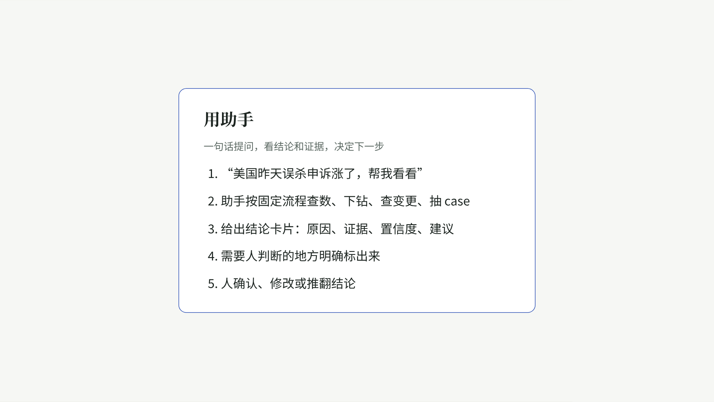
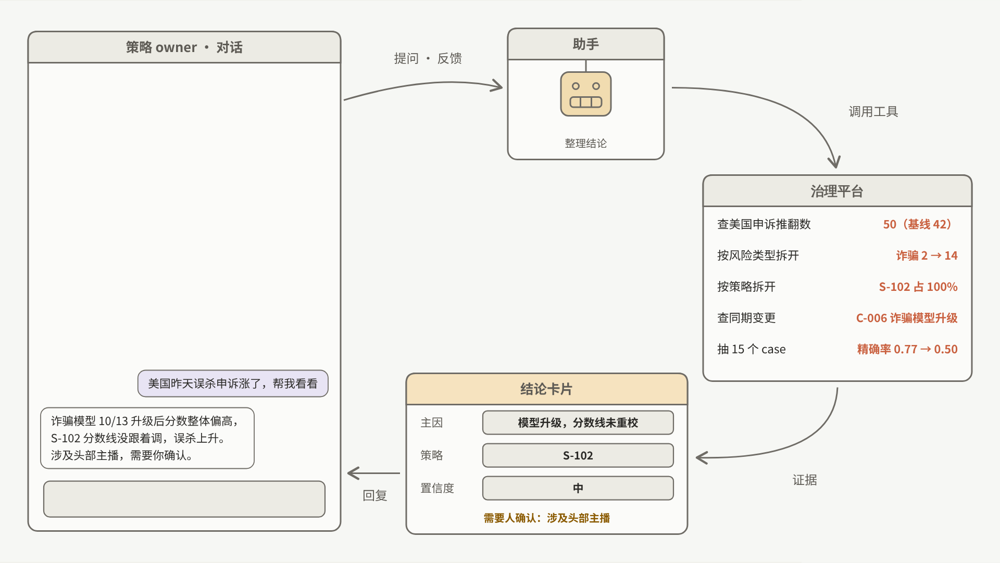
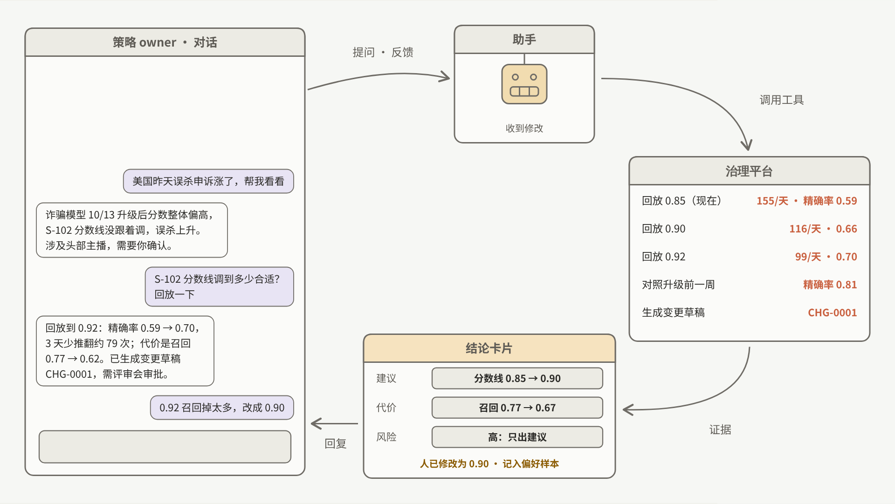
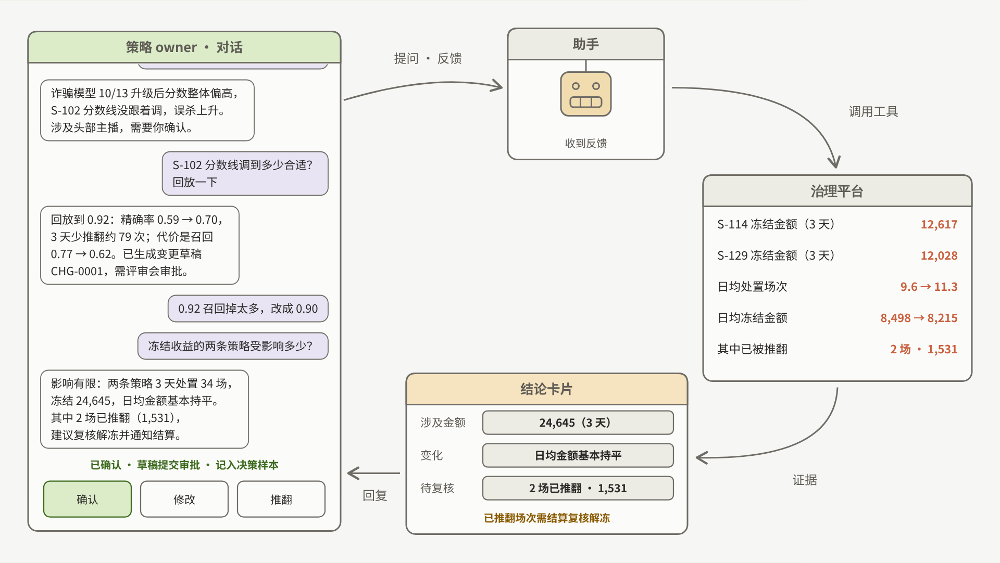

# [PRD] 直播治理平台 Agent 化：治理策略巡检与异常归因助手（产品视角，v1.0）

Oct 18, 2026 · Dekun Sun · 所有策略、市场、公会、数字均为合成数据；信息来源仅限公开资料与本仓库原型。

长版背景、机会评估与数据飞轮见 [docs/PRD.md](PRD.md)；本文是面向评审与上线的精简版，结构按"版本记录 → 摘要 → 背景 → 目标 → 需求细节 → 埋点 → 文案 → 分阶段上线 → 检查清单"组织，研发视角见 [technical-one-pager.md](technical-one-pager.md)。

## 版本记录

| 日期 | 作者 | 变更 |
|---|---|---|
| 2026-10-16 | Dekun Sun | 背景、用户、核心场景、架构（长版 PRD v0.1） |
| 2026-10-17 | Dekun Sun | 公会维度、流程图、数据飞轮；用户改为 policy / 业务治理运营 / 公会治理 / 风险策略 |
| 2026-10-18 | Dekun Sun | 资金侧处置、公会健康分；原型与模拟数据说明；后训练结果；本精简版 v1.0 |
| 2026-10-19 | Dekun Sun | 后训练结果更新：补稀有类示范后 4B 92%–94%、8B 96%；GRPO 第二版小幅正向，多种子验证中（v1.1） |

## 执行摘要（必填）

直播治理平台已经有完整的策略库、指标、变更日志和抽检样本，但策略 owner 每天仍要手动在十几个页面之间来回翻，才能回答"处罚为什么涨了"和"这条策略还健不健康"。本需求在现有平台之上加一个会话式助手：用户一句话提问，助手调用平台的只读工具查数、下钻、查变更、看漂移，给出带证据编号的结论卡片；用户确认、修改或推翻，每一次确认都沉淀为训练样本。助手不直接改任何策略：策略修改只生成草稿走审批，资金类动作只标注"需要财务审批"。

原型已经在合成世界上跑通整条链路：规则引擎版 37 道标准答案题全对、幻觉 0；开源 4B 模型做一轮监督微调后，194 道归因测试题从 3% 提到 79%–85%（三个随机种子）；补上稀有类示范（召回下降、"误判率上升"问法）后到 92%–94%，150 道策略调整题从 21% 提到 69%；同样的数据训 8B 到 96%，只比 4B 多对 4 题。再改策略调整题示范里的"想法"写法后，策略调整题到 89%–97%。在此之上的强化学习（GRPO）三个种子验证：归因无可靠提升，策略调整题小幅提升；当前可用版本是补数据后的 4B SFT 版。下一步是在一个种子团队里做只读并行对照，门槛达标再开巡检推送和变更草稿。

**关联文档**：长版 PRD [docs/PRD.md](PRD.md) · 技术一页纸 [technical-one-pager.md](technical-one-pager.md) · 模拟策略库 [simulated-strategy-library.md](simulated-strategy-library.md) · 模拟数据 [simulated-data.md](simulated-data.md) · 评估报告 [../reports/eval_report.md](../reports/eval_report.md) · 后训练报告 [../reports/posttrain_report.md](../reports/posttrain_report.md) · 演示页源码 [../demo/](../demo/)

## 1. 背景

### 现在的用户体验是什么样

| 用户要做的事 | 现在的路径（示意） |
|---|---|
| 回答"英国暴力血腥 10 月 14 日处罚为什么涨了" | 1. 打开指标看板查处罚量 → 2. 换页面查同期流量 → 3. 按策略下钻找增量来源 → 4. 翻变更日志看同期有没有模型升级 → 5. 打开分数分布页看漂移 → 6. 抽样看 case → 7. 在群里写结论。约 30–60 分钟，中间任何一步漏掉都会得出错误结论（最常见：没排除流量上涨就归因为模型问题） |
| 判断"这条策略还健不健康" | 没有固定页面；靠 owner 记得去看精确率、申诉推翻率、命中集中度。僵尸策略、重叠策略通常在出事后才被发现 |
| 把一条 policy 更新落成策略修改 | 读 policy 文本 → 找对应策略 → 手动试几个分数线 → 回测 → 写变更单。约半天 |

### 我们面对的问题

1. **归因慢且容易错**：步骤多、口径陷阱多（流量、分母、小市场样本少），结论质量取决于个人经验。
2. **巡检没有产品化**：问题靠人记得去看，发现时往往已经造成误伤或漏放。
3. **知识没有沉淀**：每次归因的推理过程留在聊天记录里，新同学无法复用，也没有数据可以训练模型。
4. **跨市场不一致**：同一类问题在不同市场由不同人判断，升级标准不统一。

### 这一期的计划

| 优先级 | 事项 |
|---|---|
| P0 | 异常归因：一句话提问 → 带证据的结论卡片 → 人确认 / 修改 / 推翻 |
| P0 | 评估集与评分器：标准答案题、8 项确定性评分，每次发版跑回归 |
| P1 | 策略健康巡检：定时扫描 → 推送给策略 owner |
| P1 | Policy-to-Strategy：policy 文本 → 可回测的策略修改草稿（仍需审批） |
| P2 | 用确认后的结论做后训练（SFT → RL），把能力沉淀到自有模型 |

### 用例

**用例 1：异常归因（P0）。** 用户："印尼赌博场景这周误判率上升了。"助手先查流量排除流量驱动 → 按策略下钻 → 查同期变更 → 检查模型分数漂移 → 给出"主因：模型升级后分数漂移，S-116 固定阈值失效；次要：无；建议：策略 owner 评估阈值重校；不需要升级"。用户把建议分数线从 0.92 改成 0.90 后确认。

**用例 2：没有异常 / 数据不足（P0）。** 用户问一个其实正常的波动，助手答"属正常波动，未发现异常"；小市场样本不足时答"数据不足，建议扩大窗口或人工复核"。这两类占测试集约三分之一，是误报控制的关键。

**用例 3：巡检发现并推送（P1）。** 每日巡检发现某条策略 14 天命中为 0（僵尸）或两条策略命中高度重叠，推送给 owner，附证据与建议动作。

**用例 4：policy 更新落地（P1）。** Policy 更新"赌博人审量不超过每天 28 场，覆盖率不低于 78%，精确率不低于 92%"。助手找到对应的转人审策略，回测一组分数线，给出满足三个约束的最保守解，生成变更单草稿，标注是否涉及资金侧审批。

## 2. 目标

| 上线范围 | 用户价值与业务价值 | 成功指标（上线后看什么） |
|---|---|---|
| 一个策略团队，6 个市场中的 2 个大市场先行；小市场只读 | 用户：归因从 30–60 分钟降到 5 分钟内，结论有证据可追溯。业务：异常定位时长缩短，策略迭代周期缩短，误伤更早被发现；确认后的结论成为训练数据 | 北极星：经人确认的治理决策数（周）。护栏：采纳率 ≥ 60%、推翻率 ≤ 10%、幻觉 0、误处罚不劣于上线前。详见长版 PRD 的"指标口径" |

**非目标**：不做内容检测模型；不直接执行策略修改和资金动作；不对单个主播或公会做处置建议；不替代 policy 条文解释。

## 3. 需求细节与演示

演示见 [demo/](../demo/)（合作方版对话演示页）与 [docs/media/assistant-flow.mp4](media/assistant-flow.mp4)。

### 3.1 功能清单

| 模块 | 功能描述 | 示意 |
|---|---|---|
| 1. 入口与开场 | 平台右上角常驻入口。打开后显示：本周巡检发现（若有，按严重度排序，最多 3 条）+ 按当前页面推荐的 3 个冷启动问题（例如在策略详情页：这条策略最近健康吗 / 命中为什么变了 / 和哪些策略重叠） |  |
| 2. 提问与范围识别 | 支持中文自然语言；助手从问题里解析市场、场景、日期，解析不出的字段先确认再查（避免"需要澄清"类问题被猜）。输入上限 200 字 | |
| 3. 调用过程可见 | 每一步工具调用以折叠行展示：调用了什么、看到了什么（带证据编号 Q-0001 等）。用户可随时展开 |  |
| 4. 结论卡片 | 字段固定：主因（10 类枚举之一）、相关策略 / 变更 / 公会编号、是否需要升级、一句话结论、建议动作。编号必须在本轮观察中出现过，否则卡片不会生成 | |
| 5. 人工修改 | 卡片上的数值（分数线、窗口）和主因可直接改；修改会被记录为"修改后确认"并带原值 |  |
| 6. 确认 / 推翻 | 确认进入决策记录；推翻必须选原因（主因错、证据不足、口径错、其他）。两者都写入训练样本池 |  |
| 7. 升级 | 命中升级规则（资金侧、头部主播、处罚量周环比 ×2、小市场样本不足）时卡片顶部出现"需要人工复核"，并把完整调用轨迹和证据卡片带给接手的人 | |
| 8. 变更草稿（P1） | Policy-to-Strategy 结果以变更单草稿呈现：目标策略、分数线、动作、是否需财务审批、回测结果；只能"提交审批"，不能"直接生效" | |
| 9. 反馈 | 每张卡片有有用 / 没用；"没用"必须选原因（答非所问、主因错、漏证据、太慢、格式问题、其他） | |
| 10. 结束与超时 | 2 小时无交互自动结束会话并请求反馈；新会话重新显示开场 | |

### 3.2 关键逻辑

- **先查流量**：任何"处罚涨了 / 命中掉了"类问题，提交结论前必须查过流量；没查的提交会被拒收并提示下一步。
- **编号校验**：策略 / 变更 / 公会编号必须出现在本轮工具返回里；不存在的编号会被拦截并列出已见编号。
- **调用预算**：单次归因最多 14 次调用；剩 2 次时提示尽快提交，没把握就选"数据不足"或"需要澄清"。
- **主因枚举**：模型漂移、召回下降（规避）、流量驱动、policy / 策略变更、新策略上线、公会集中违规、公会真实违规、公会不合理扣分、没有异常、数据不足、需要澄清。
- **权限**：助手所有工具只读；唯一的"写"是生成草稿。

### 3.3 内容准备

| 项目 | 内容 |
|---|---|
| 开场语 | "我是治理策略助手。可以问我某个市场、场景的处罚 / 命中 / 误判变化的原因，或某条策略最近是否健康。我只读平台数据，结论都带证据编号，修改策略需要你确认。" |
| 冷启动问题 | 按页面配置；首版用各页面最高频的 3 个问题 |
| 默认回答 | 超出范围时："这个问题不在我的能力范围（治理分类之外 / policy 条文解释），建议查看 ___ 或联系 ___。" |
| 数据不足 | "样本不足以下结论（___ 市场 ___ 天只有 ___ 场），建议扩大窗口或人工复核。" |

## 4. 埋点

| 事件 | 字段 | 用途 |
|---|---|---|
| session_open | 入口页面、是否有巡检发现 | 渗透与入口分析 |
| query_submit | 问题文本（脱敏）、解析出的市场 / 场景 / 日期、是否触发澄清 | 范围识别准确率 |
| tool_call | 工具名、参数、耗时、是否报错、是否被规整 | harness 失败归类 |
| card_render | 主因、编号数、是否升级、调用次数、总耗时 | 质量与成本 |
| card_edit | 改了哪个字段、原值、新值 | 修改类样本 |
| card_decision | 确认 / 修改后确认 / 推翻（原因） | 北极星、采纳率、训练样本 |
| feedback | 有用 / 没用（原因） | 质量 |
| escalation | 触发规则、接手人 | 升级正确率 |

## 5. 文案（示例键）

| 键 | 场景 | 中文文案 |
|---|---|---|
| ga_card_need_review | 命中升级规则 | 需要人工复核：{reason} |
| ga_card_no_anomaly | 没有异常 | 属正常波动，未发现异常（{metric} {date}={v}，前 7 天中位数 {median}） |
| ga_card_insufficient | 数据不足 | 样本不足以下结论，建议扩大窗口或人工复核 |
| ga_gate_traffic | 未查流量就提交 | 提交前请先确认流量变化（sessions），排除流量驱动 |
| ga_gate_ids | 编号不存在 | 编号 {id} 没有在本轮数据里出现过；已出现的编号：{seen} |
| ga_budget_left | 剩 2 次调用 | 还剩 {n} 次调用，请尽快提交结论 |
| ga_feedback_bad_reason | 点"没用"后 | 哪里不对：答非所问 / 主因错 / 漏证据 / 太慢 / 格式 / 其他 |

## 6. 分阶段上线计划

| 阶段 | 用户 | 时间（示例） | 目标 | 退出条件 |
|---|---|---|---|---|
| 内测 | 产品 + 2 位策略同学 | 第 1–2 周 | 标准答案集跑通，收集阻塞问题 | 标准答案集 ≥ 80%，幻觉 0，单次归因 < 3 分钟 |
| 封闭 Alpha | 种子团队 3–5 人，归因只读，与人工并行 | 第 3–6 周 | 对比助手结论与人工结论 | 采纳率 ≥ 60%，推翻 ≤ 10%，没有未归类的失败 |
| 开放 Alpha | 同团队全体，开巡检推送 | 第 7–10 周 | 渗透率与巡检误报 | 任一市场准确率不低于整体 10 个点；巡检误报率可接受、重大问题不漏 |
| Beta | 第二个团队，开变更草稿（审批） | 第 11 周起 | 复现 Alpha 结果 | 第二团队重复 Alpha 门槛；草稿返工率下降 |
| GA | 全部策略团队 | 待定 | — | 待定 |

**灰度期度量**：关键指标 = 经人确认的治理决策数；跟踪指标 = 采纳率、推翻率、定位时长、每题调用次数与耗时、工具报错率、巡检误报 / 漏报。

## 检查清单（必填）

- [ ] 文档对所有相关方开放阅读
- [ ] 与各市场 owner 对齐上线范围差异（小市场只读）
- [ ] 上下游（指标、变更日志、抽检）的接口口径对齐
- [ ] 文案已照通用助手产品的惯例检查（能做 / 经许可才做 / 不做）
- [ ] 数据权限与保留期限走现有数据治理流程
- [ ] 预留足够的培训与说明时间（每个 playbook 一页说明）

## 附录

- 失败归类（harness 可修 vs 需要训练）与后训练各阶段结果：[../reports/posttrain_report.md](../reports/posttrain_report.md)
- 策略链路与金融风控对照、参考的公开岗位：[docs/PRD.md](PRD.md) 附录
