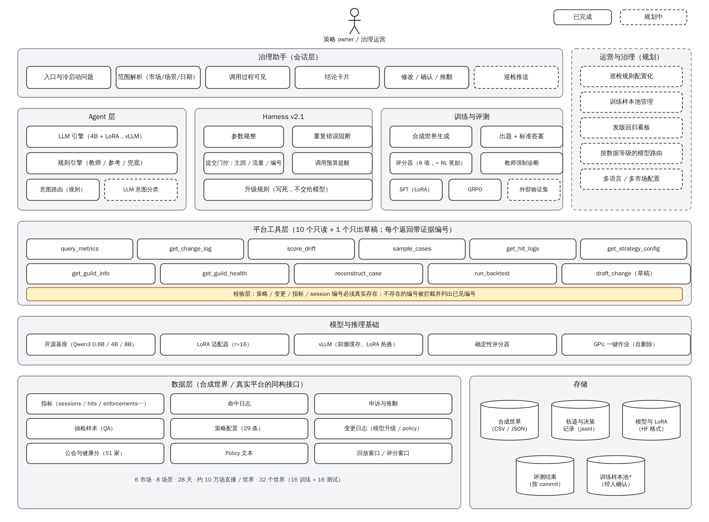
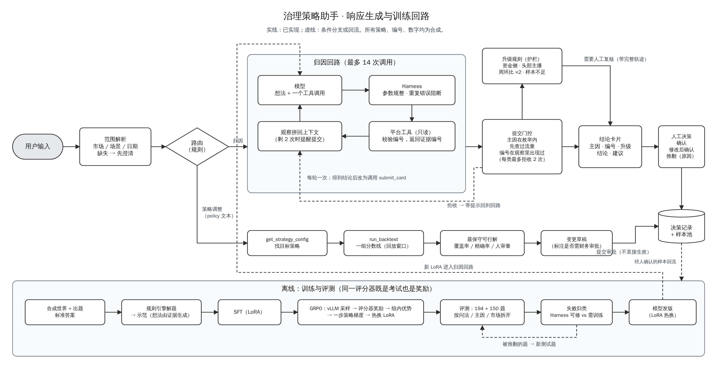

# 治理策略助手 技术一页纸（研发视角）

Oct 18, 2026 · Dekun Sun · 全部基于本仓库的可运行原型与合成数据；不含任何真实平台的内部实现。

## 简介

**背景。** 直播治理平台有现成的指标、变更日志、分数分布和抽检样本，但"异常归因"和"策略巡检"仍是人工多步操作。本项目在平台之上实现一个会话式 Agent：模型通过只读工具查数、下钻、归因，输出结构化结论卡片；一个确定性评分器既做评测也做强化学习的奖励；经人确认的结论回流为训练数据。产品需求见 [prd-governance-agent.md](prd-governance-agent.md)。

**演示。** [demo/](../demo/)（12 个回放场景的对话演示页）与 [media/assistant-flow.mp4](media/assistant-flow.mp4)。

## 问题陈述

1. **长链路推理**：一次归因平均 5–9 次工具调用，中间有分支（查到命中集中在一条策略 → 去查变更；查到同期有模型升级 → 去查分数漂移）。错一步，后面的观察就是模型没见过的分支。
2. **口径陷阱**：处罚量上涨常常只是流量上涨；小市场样本少；申诉率的分母会变。通用模型在这些题上系统性地"看见异常"（未训练的 4B 把 48 道"没有异常"的题答成异常 40 道）。
3. **编号幻觉的代价高**：结论要引用策略 / 变更 / 公会编号，编错一个就会改错策略。
4. **没有标准答案就没法迭代**：真实场景里结论难以自动判对错，评测和训练都做不起来。

## 我们的方案

- **平台工具层**（`gov_platform/`）：11 个工具，10 个只读 + 1 个只出草稿；每个返回带证据编号（Q-0001…）；校验层拦截不存在的策略 / 变更 / 指标 / session 编号。
- **Agent 层**（`agent/`）：两个引擎共用同一套工具与 playbook：规则引擎（确定性，作为教师与参考答案）和 LLM 引擎（tool-use 回路）；升级规则写死在护栏里，不交给模型。
- **合成世界**（`data/generate.py`、`posttrain/worlds.py`）：按配置生成"平行世界"（28 天、6 市场、8 场景、29 条策略、51 家公会、约 10 万场直播），埋入 11 类已知答案的问题；32 个世界分训练 / 测试。
- **Harness**（`posttrain/harness_v2.py`、`posttrain/p2s.py`）：把 Agent 与环境的交互标准化：参数规整（别名、日期裁剪、维度名纠正）、重复错误阻断、提交门控（主因枚举 / 先查流量 / 编号必须见过）、调用预算提醒。
- **评分器**（`harness.grade`）：8 项确定性标准（是否提交、主因、策略 / 变更 / 公会编号、升级判断、无幻觉、先查流量），全对才算通过；同一评分器作为 RL 奖励。
- **后训练**（`posttrain/train_sft.py`、`posttrain/grpo2.py`）：LoRA 监督微调（示范由规则引擎生成，想法由证据生成，稀有类过采样）→ GRPO 第二版（vLLM 采样、按通过率挑题、PPO 裁剪 + KL、探针早停、热换 LoRA）。

## 指标

| 指标 | 定义 | 目前（合成世界） |
|---|---|---|
| 通过率（北极星，离线） | 8 项全对的题数 ÷ 题数 | 4B SFT 2 epoch：94%–96%（194 题，2 种子）；1 epoch 的 9 次运行在 88%–98% 之间波动；8B 96% |
| 主因准确率 | 主因在可接受集合内 | 4B SFT 2 epoch 94%–96%；8B 96% |
| 幻觉率 | 引用不存在编号的结论 ÷ 结论数 | 0（校验层拦截） |
| 先查流量 | 提交前查过 sessions | 100% |
| 有效对话率 | （总题数 − 未提交 − 门控两次拒收 − 格式错误）÷ 总题数 | 4B SFT 99.5%–100%；8B 99.5%；GRPO v2 98.5% |
| 延迟 | 单题中位耗时（vLLM，A40） | 约 18 s |
| 成本 | 单题生成 token | 约 600–850 |

有效对话率的分母里，"未提交"包括回合用完仍在查的情况（未训练模型 13%–29%，训练后 < 3%）。

## 产品能力

| 能力 | 说明 |
|---|---|
| 异常归因 | 一句话问题 → 多步查证 → 结论卡片（10 类主因、编号、升级、建议） |
| 策略健康巡检 | 定时扫描：僵尸策略、策略重叠、精确率下滑、命中集中、公会健康分异常 → 推送 |
| Case 证据包 | 对单条策略 / 变更把相关指标、样本、变更打包，供审批与申诉复查 |
| Policy-to-Strategy | policy 文本 → 目标策略 → 一组分数线回测 → 最保守可行解 → 变更草稿（含是否需财务审批） |
| 通用能力 | 冷启动问题按页面配置；调用过程可见；修改 / 确认 / 推翻全部记录 |

## 同类产品参考

公开资料中，电商卖家平台的助手在 2026 年已从问答工具升级为"回答 → 推理 → 规划 → 经许可执行"的 agentic AI，强调实时上下文、引导式动作（检查条件 → 分步引导 → 生成材料）和转人工带完整记录。本项目与之共享原则，差别在任务深度（十来步推理）、是否有确定性标准答案（有，因此能自动评测与后训练）和错误后果（影响整个市场的处置，因此只提方案、分级审批）。

## 技术设计

### 术语

| 术语 | 定义 | 例子 |
|---|---|---|
| 世界（world） | 一次合成数据生成的结果：数据 + 埋入的问题 + 标准答案 | w16–w31 为测试世界 |
| 任务（task） | 一个世界里的一道题：问题文本（A/B 两种问法）、日期、可接受主因、必需编号 | "英国暴力血腥 10 月 14 日处罚涨了" |
| Harness | Agent 与环境之间的标准化层：解析、规整、门控、预算 | v1 冻结用于对照；v2.1 当前 |
| 评分器（grader） | 8 项确定性检查，输出通过与得分 | 也是 RL 奖励 |
| 示范（demonstration） | 规则引擎解题过程改写成的对话轨迹，每步想法由上一步观察生成 | 374 条（两种措辞） |
| 教师强制诊断 | 把示范 token 原样喂给训练后的模型，看每个 token 的贪心预测是否一致 | 用于判断"训练与推理是否一致" |

### 系统概览



（源文件 `docs/diagrams/build.py` 生成 SVG，`docs/diagrams/render.js` 渲染 PNG；SVG 版见 [images/arch-layers.svg](images/arch-layers.svg)。）

离线链路：合成世界生成 → 出题与标准答案 → 示范 → SFT → GRPO → 评测（同一评分器）。在线回流：确认 / 修改 / 推翻 → 训练样本池（只收经人确认的）。

### 响应生成流程



1. **范围解析**：从问题里抽市场、场景、日期；缺失字段先澄清。
2. **循环**（最多 14 次）：模型输出一段想法 + 一个工具调用 → Harness 规整参数并执行 → 观察拼回上下文。
3. **提交门控**：主因必须在枚举内；没查过流量不收；编号必须在观察里出现过；每类最多拒收两次。
4. **卡片渲染**：主因、编号、升级、结论、建议；升级规则由护栏判定，不由模型决定。
5. **人工决策**：确认 / 修改后确认 / 推翻（原因）→ 记录。

### 意图与路由

当前只有两类入口（归因、策略调整），用规则路由：含"policy / 分数线 / 人审量"关键词走 Policy-to-Strategy，其余走归因；巡检是定时任务不是对话。先不上 LLM 意图分类，等第三类任务出现再评估。

### 示范与训练数据

- 示范由规则引擎生成，再按"想法由证据生成"的模板改写（例如"S-102 占增量 100%，且同期有模型升级 C-006 → 检查分数漂移"），不是固定模板。教师强制诊断显示：模板式示范下模型 token 一致率 99.8% 但分支点就错，改为证据式示范后新问法不再掉分。
- 训练 / 测试世界严格分离；测试世界包含训练中未出现的组合。

### 技术选型

| 决策 | 备选 | 选择与理由 |
|---|---|---|
| 模型 | 0.6B / 4B / 8B 开源模型；闭源 API | 原型用 4B：0.6B 新问法掉一半；8B 在归因上更爱继续查、不下结论，策略调整上更强（41% 对 16%，未训练）；成本与延迟 4B 更好。闭源 API 用于规则引擎之外的对照，不作为训练对象 |
| 推理服务 | 进程内 transformers / vLLM | 评测与 RL 采样用 vLLM（前缀缓存、LoRA 热换），CPU 调试用进程内 |
| 训练 | 全量微调 / LoRA | LoRA r=16：一轮 17 分钟（A40），便于多种子与热换 |
| RL 算法 | PPO / GRPO | GRPO：奖励确定、无需价值网络；组内归一化天然只在"有时对有时错"的题上产生梯度 |
| 奖励 | LLM 评审 / 确定性评分器 | 确定性评分器（8 项）+ 通过加 1；可复现、不可被"讨好" |
| 前后端通信 | HTTP / SSE / WebSocket | 原型 HTTP；延迟主要在模型侧，不需要双向长连接 |

### 重大挑战

1. **数据敏感与权限**：助手只读；草稿不生效；编号校验在工具层；真实部署时按数据等级选择内部 / 外部模型，敏感字段以占位符替换。
2. **幻觉**：编号校验 + 门控拒收 + 评分器 0 容忍；结论必须引用证据编号。
3. **判断类错误**：未训练模型的主要失败是"在证据面前选错主因"（73%–77%），不是格式；这类靠示范数据与 RL 奖励修，Harness 修不了。
4. **Harness 与模型的边界**：两处工具交互失败（维度名当指标名、market=ALL 被拒）曾占未提交的多数；修 Harness 比训练便宜得多，所以顺序是先修 Harness 再训练。
5. **训练与评测的循环**：题目、答案、示范都来自同一个规则引擎，分数衡量的是"与规则引擎一致"的程度。外部验证（由采用方的策略 / 运营同学按 `docs/external-validation-template.md` 标 30–50 道真实题）是上线前的门槛，原型阶段没有标注者，所以本项目的所有数字只对合成世界成立，文档里不假装有真实数据。

### 反馈回路

```
巡检 / 提问 → 助手结论 → 人确认 / 修改 / 推翻 → 训练样本池（只收经人确认的；修改带原值）
      ▲                                                     │
      └──────── 评测集扩充（被推翻的题成为新测试题） ◄────── SFT / GRPO
```

### 运维工作流

- 每次发版：在 194 + 150 题测试集跑评测，报告按问法 / 主因 / 市场拆开的通过率与失败归类；只追加评分规则，不改已有规则（`make check` 跑评分器单元测试、参考解法回放、测试集校验和、演示页可重建性）。
- 训练：GPU Pod 一键脚本（克隆 → 造世界 → 训练 → 评测 → 打包结果 → 自删除），结果与 commit 绑定。
- 线上：卡片决策与反馈进样本池；每周看采纳率、推翻率与推翻原因分布。

## 改进与挑战（已做的，和剩下的）

- 召回下降类任务三个种子都接近 0：示范只有 9 条且模型不去查召回估计 → 已补示范（+16 个训练世界、稀有类过采样，示范 374 → 831 条），召回类 0/11 → 11/11，整体 85% → 92%–94%（报告第 13 节）。剩余短板是"误判率上升"问法下的升级判断（44%–56%）。
- GRPO 第一轮（9 轮、2 GPU 小时）没有可测量提升；第二版（挑 20%–60% 通过率的题、稀有类加权、PPO 裁剪 + KL、探针早停、学习率 5e-6）三个 RL 种子：归因 +4 / +1 / 0 题（噪声内），策略调整题 +3 / +7 / +17（一致的小幅提升，涨在分数线达标上）（报告第 14 节）。学习率 2e-5 三轮就把起点打坏：RL 对步长极其敏感。同一笔钱花在修示范上提升是 RL 的几倍，RL 放在最后一步。
- Policy-to-Strategy 的"收紧分数线"题：剩余 45 道失败全是分数线在评分窗口不达标 → 示范的"想法"改为写出约束、可行分数线和"取覆盖率最高且留余量"的选择规则后，三次运行 134 / 143 / 145（150 题，原来 103）；再加一套训练专用问法后 145/150，"新建还是修改"的判断全对（报告第 16 节）。归因的运行间波动（170–191 题）在只训归因的对照里同样存在（177 / 181），不是 P2S 示范造成的；混合数据训 2 个 epoch 两边都保住（两个种子归因 182 / 186、P2S 147 / 136），是当前可用版本。
- 多模型路由（敏感数据走内部模型）、多语言、巡检规则的配置化。
- **剩下的都依赖采用方**：外部验证集的标注、真实基线四个数的采集、只读并行对照的运行。原型侧的工作到此为止；再在合成数据上加实验，边际价值已经很低（归因单次运行的波动比剩余的提升空间还大）。

## 路线图

| | 本季 | 下季 | 之后 |
|---|---|---|---|
| 功能 | 归因只读 + 结论卡片 + 人工决策 | 巡检推送 + 变更草稿 | 第二团队、更多任务类型 |
| 基础 | 评测集与评分器、Harness v2.1、SFT | GRPO、外部验证集、发版回归 | 内部模型路由、配置化巡检 |
| 生态 | 平台只读工具接入 | 审批流对接、证据包导出 | 其他治理团队的 playbook 接入 |

## 参考

- 产品需求：[prd-governance-agent.md](prd-governance-agent.md)、长版 [PRD.md](PRD.md)
- 评估报告：[../reports/eval_report.md](../reports/eval_report.md)；后训练报告：[../reports/posttrain_report.md](../reports/posttrain_report.md)
- GPU 运行手册：[../posttrain/gpu/README.md](../posttrain/gpu/README.md)
- 模拟策略库 / 模拟数据：[simulated-strategy-library.md](simulated-strategy-library.md)、[simulated-data.md](simulated-data.md)
