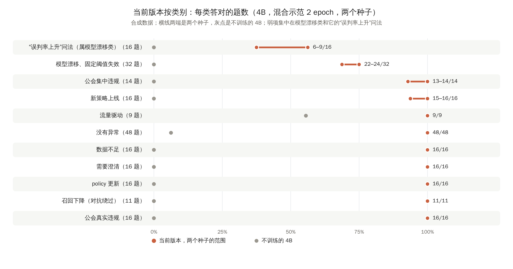
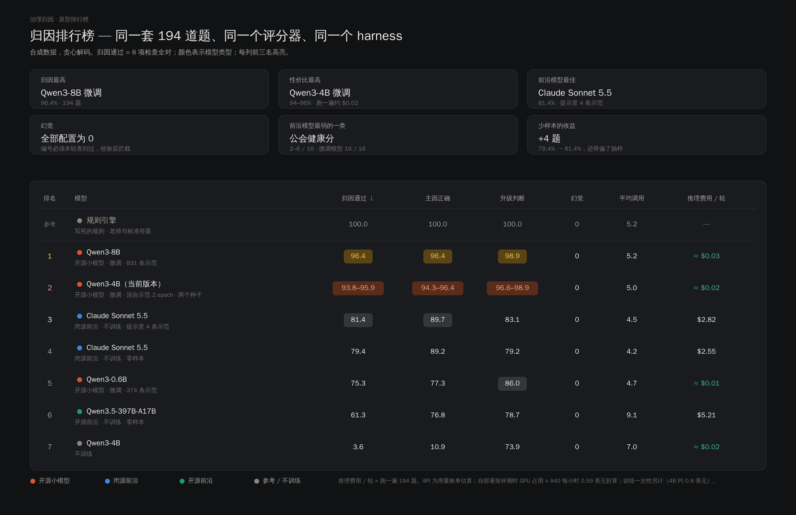
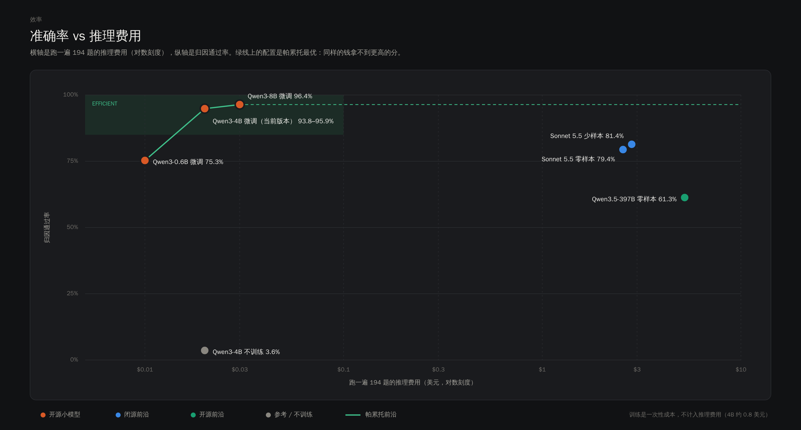
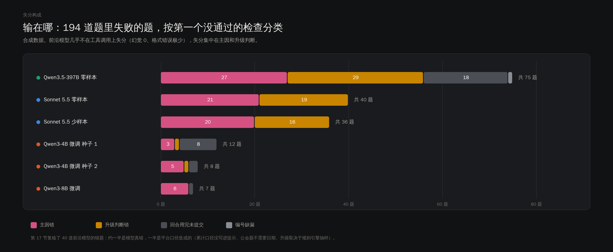
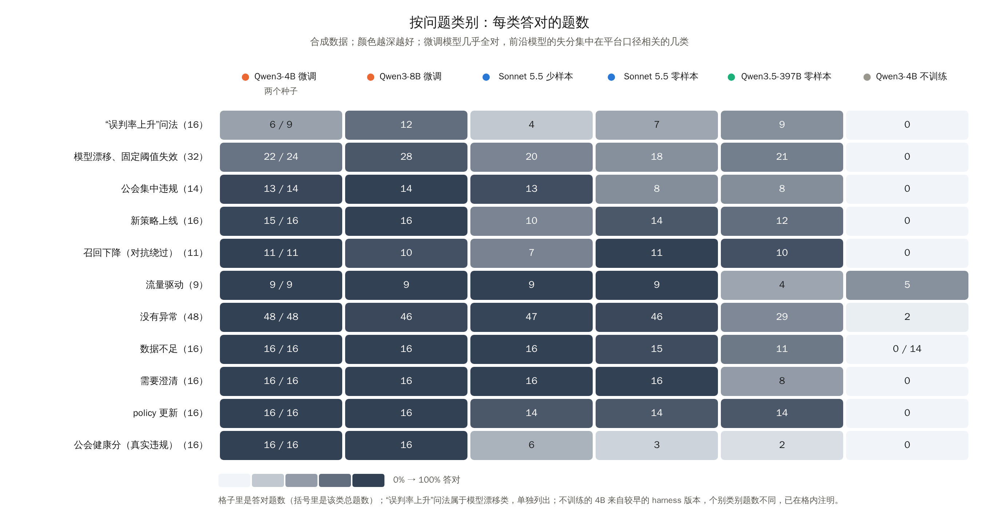

# 治理策略助手 原型技术说明（PRD 附件，研发视角，v1.9）

Oct 21, 2026 · Dekun Sun · 全部基于本仓库的可运行原型与合成数据；不含任何真实平台的内部实现。

本文是 [PRD.md](PRD.md) 的研发附件，从研发视角回答三件事：系统怎么搭、关键选择为什么这样选、现在做到了什么。背景、目标、方案选型、结果与结论以 PRD 为准，这里不重复。后训练过程与全部数字见 [../reports/posttrain_report.md](../reports/posttrain_report.md)。

**数字的约定**：本文的数字几乎都来自原型（合成世界），只说明技术上可行，不代表真实业务；凡写 xxx / xx 的地方是上线前要由使用方定的真实门槛；市场、场景、策略编号都是示例。

| 模块 | 本文的具体内容 | 解决的问题 |
|---|---|---|
| 1. 技术难点与技术指标 | 四个技术难点；PRD 之外的三项技术指标 | 技术上要解决什么、做到什么算好 |
| 2. 方案 | 系统概览与组件、响应生成、意图路由、证据检索、知识库、口径知识库（RAG）设计、专门能力、Agent 编排、提示与示范迭代、术语 | 系统怎么搭 |
| 3. 关键设计决策 | 标准答案来源、奖励、Harness 边界、模型、训练、推理、通信 | 为什么选这些 |
| 4. 评测与结果 | 评测集构建、评分器与错误分级、失败归类、训练配置、结果（按类别、多种子、波动、外部模型对比）、费用 | 现在做到了什么 |
| 5. 真实数据如何进入评测环境 | 快照、题、答案、评分器、切分、半合成、交付形态 | 环境怎么从合成换成真实 |
| 6. 在线学习（之后做） | 信号管道、奖励组成、防标签污染、延迟真值回填、发布闸门与回滚 | 怎么边用边变好又不失控 |
| 7. 风险与开放问题 | 可信度边界、幻觉、权限、样本偏差 | 还有什么没解决 |
| 8. 路线图 | 功能、基础设施、生态 | 如何逐步落地 |

演示：[demo/](../demo/)（12 个回放场景的对话演示页）与 [media/assistant-flow.mp4](media/assistant-flow.mp4)。

**三条主线**：本文按 AI 产品的三件事组织，每件事对应下面的章节。

| 主线 | 回答什么 | 原型里做了什么 | 在哪 |
|---|---|---|---|
| 评测：定义什么是好 | 什么必须对、什么错误可以接受、怎么判、怎么防自己骗自己；落地后看哪些过程和结果指标、bad case 怎么回流 | 8 项确定性检查全对才通过；错误按代价分级（零容忍 / 门槛 / 可接受）；测试集锁定、问法留出、多种子；失败按第一个出错步骤归类 | 4.1–4.3、4.6；落地评测见 PRD 第 5 节 |
| Agent 架构：把业务流程变成可执行的系统 | 单 agent 还是多 agent、什么时候调工具、怎么路由、多轮怎么处理、人在哪里介入 | 单 agent + playbook + 只读工具；意图路由与范围解析；提交门控与调用预算；状态机式多轮；护栏与人工裁决写在代码里 | 2.1–2.4、2.8 |
| 模型、知识与提示 | 用哪个模型、知识怎么给到模型、提示怎么迭代 | 三类模型同一环境跑基准（效果 / 成本 / 失分构成）；口径知识库（RAG）的设计；提示与示范的迭代记录 | 2.5–2.6、2.9、4.5 |

## 1. 技术难点与技术指标

**四个技术难点。**

1. **长链路推理**：一次归因平均 5–9 次工具调用，中间有分支（查到命中集中在一条策略 → 去查变更；查到同期有模型升级 → 去查分数漂移）。错一步，后面的观察就是模型没见过的分支。
2. **口径问题**：处罚量上涨可能只是流量上涨；小市场样本少；申诉率的分母会变。通用模型在这些题上系统性地"看见异常"（未训练的 4B 把 48 道"没有异常"的题答成异常 40 道）。
3. **编号幻觉的代价高**：结论要引用策略 / 变更 / 公会编号，编错一个就会改错策略。
4. **没有标准答案就没法迭代**：真实场景里结论难以自动判对错，评测和训练都做不起来。

**PRD 之外的技术指标**（通过率与幻觉率按 PRD 第 2 节的护栏执行）：

| 目标 | 口径 | 门槛 |
|---|---|---|
| 有效对话率 | （总题数 − 未提交 − 门控两次拒收 − 格式错误）÷ 总题数 | ≥ xx% |
| 延迟 / 成本 | 单题中位耗时；单题生成 token | < xx s；< xx token |
| 可复现 | 测试集字节级锁定；评分规则只追加不修改 | `make check` 通过 |

## 2. 方案

### 2.1 系统概览与组件

（源文件 `docs/diagrams/build.py` 生成 SVG，`docs/diagrams/render.js` 渲染 PNG；SVG 版见 [images/arch-layers.svg](images/arch-layers.svg)。）

| 组件 | 代码 | 职责 |
|---|---|---|
| 会话层 | `app/app.py`、`demo/` | 对话界面：卡片、证据、"在平台打开"、可展开轨迹；确认 / 修改 / 推翻 |
| Agent 层 | `agent/` | 两个引擎共用同一套工具与 playbook：规则引擎（确定性，作为教师与参考答案）和 LLM 引擎（tool-use 回路）；升级规则写死在护栏里 |
| Harness | `posttrain/harness_v2.py`、`posttrain/p2s.py` | 参数规整（别名、日期裁剪、维度名纠正）、重复错误阻断、提交门控（主因枚举 / 先查流量 / 编号必须见过）、调用预算提醒 |
| 平台工具层 | `gov_platform/` | 11 个工具：10 个只读 + 1 个只出草稿；每个返回带证据编号；校验层拦截不存在的策略 / 变更 / 指标 / session 编号 |
| 合成世界 | `data/generate.py`、`posttrain/worlds.py` | 按配置生成"平行世界"（28 天、6 市场、8 场景、29 条策略、51 家公会、约 10 万场直播），埋入 11 类已知答案的问题；训练 / 测试世界分离 |
| 评分器 | `harness.grade` | 8 项确定性标准，全对才算通过；同一评分器作为 RL 奖励 |
| 训练与评测 | `posttrain/train_sft.py`、`posttrain/grpo2.py`、`posttrain/evaluate.py` | LoRA SFT → GRPO v2 → 评测；GPU Pod 一键脚本 |
| 模型与推理 | vLLM + LoRA 热换 | 评测与 RL 采样；CPU 调试用进程内 transformers |

能力清单：异常归因（一句话 → 多步查证 → 结论卡片）、策略健康巡检（定时扫描：僵尸、重叠、精确率下滑、命中集中、公会健康分异常 → 推送）、Case 证据包、Policy-to-Strategy（policy 文本 → 回测 → 变更草稿，含是否需财务审批）。

### 2.2 响应生成：如何处理不同任务

| 任务 | 入口 | 处理方式 | 输出 |
|---|---|---|---|
| 异常归因 | 对话 | 范围解析 → 循环（次数有上限，原型取 14：想法 + 一个工具调用 → Harness 规整执行 → 观察拼回）→ 提交门控 → 卡片 | 结论卡片：主因（10 类枚举）、编号、是否升级、建议 |
| 策略调整（P2S） | 对话，含 policy 文本 | 找目标策略 → 回放一组分数线 → 取满足约束且留余量的线 → 草稿 | 变更草稿（只能提交审批；资金类标注需财务审批） |
| 策略健康巡检 | 定时任务 | 规则扫描全部线上策略；已暂停策略和预期内变化标为提示 | 待处理清单推送 |
| 没有异常 / 数据不足 / 需要澄清 | 对话 | 对照近期中位数；小市场按样本阈值；缺字段先反问 | "属正常波动" / "数据不足" / 澄清问题 |

提交门控：主因必须在枚举内；没查过流量不收；编号必须在观察里出现过；每类最多拒收两次，拒收时带可照抄的提示退回循环。升级规则由护栏判定，不由模型决定。产品层面的六步流程、状态流转和一次完整对话的示例见 PRD 第 3 节与附录 A。

### 2.3 意图路由

| 方式 | 适用 | 本项目 |
|---|---|---|
| 规则 | 入口少、关键词清晰 | **当前采用**：含"policy / 分数线 / 人审量"走 P2S，其余走归因；巡检是定时任务不是对话 |
| Embedding 相似度 | 入口多、问法多样 | 暂不需要；问法多样性靠范围解析（市场 / 场景 / 日期）而不是意图分类吸收 |
| LLM 分类 | 入口多且语义复杂 | 等第三类对话任务出现再评估；多一次模型调用会增加延迟 |

范围解析（市场、场景、日期）与意图路由分开：解析不出的字段先澄清，不猜。

### 2.4 证据检索：如何找到相关证据

本项目没有文档型 RAG：知识不在文本库里，而在平台数据里。对应"场景化检索"的是 **playbook 驱动的工具查证**：

- **顺序由 playbook 定**：先查流量（排除流量驱动）→ 按策略 / 公会 / 市场下钻找增量来源 → 查同期变更（模型、策略、policy）→ 看分数漂移与抽检精确率 → 看举报与召回估计。
- **每一步的结果带证据编号**（指标、变更、抽检样本、session），卡片只能引用本轮查到过的编号。
- **分支由证据触发**：命中集中在一条策略 → 查变更；同期有模型升级 → 查漂移；命中掉但举报没掉 → 查召回估计。示范数据里的"想法"就是把这些条件关系写出来，模型学的是条件，不是步骤位置。
- **预算**：单次调用次数有上限（原型取 14）；快用完时提醒提交。

### 2.5 知识库：知识从哪里来、如何更新

| 知识 | 来源 | 更新方式 |
|---|---|---|
| Playbook | 策略团队的标准做法，写成文档 + system prompt | 版本化；最终目标是策略团队自己编写和发布 |
| 策略库、指标、变更日志、抽检样本 | 平台现有数据，通过只读工具读取 | 平台自身更新；助手不写 |
| 主因分类法（10 类）与升级规则 | 治理分类法 + 护栏 | 评分规则只追加不修改（`tests/test_grader.py` 锁住） |
| 示范（训练数据） | 原型：规则引擎在合成世界解题生成；上线后：经人确认的结论（修改带原值） | 每次发版回归；被推翻的题成为新测试题；随机抽一部分被采纳的结论复核，作无偏校准集 |
| 评测集 | 194 道归因题 + 150 道策略调整题，测试世界与训练世界分离，md5 与内容指纹锁定 | 只追加；外部验证集由使用方标注（`external-validation-template.md`） |

**埋入问题的机制**：生成器先造每场直播的隐藏真相，再让策略机械执行、申诉和抽检按真相自然产生；埋一个问题 = 在某一步、某个市场、某个日期之后改一个参数（例如模型分数 +0.15 而分数线不动），症状由流水线自己推导，证据链自洽。11 类问题对应归因 playbook 的全部分支：误判方向（漂移、policy 更新）、漏判方向（召回下降）、"没问题但看起来有"（流量、新策略），以及三类"不动 / 不知道"（没有异常、数据不足、需要澄清）。

### 2.6 口径知识库（RAG）：上线时的设计（原型未实现）

外部基线说明前沿模型差的主要是平台口径（第 4.5 节、报告第 17 节）。口径和 policy 条文是文本，适合用检索把"本次适用的那几条"放进上下文，而不是让模型读整本文档或全部写死在提示里。

| 设计点 | 做法 |
|---|---|
| 放什么 | policy 条文；playbook 步骤；口径定义（指标名、分母、时间窗口、适用市场、生效日期）；升级条件；历史 case 的结论与裁决 |
| 怎么切 | policy 按条款切，一条一块，带上级标题、生效日期、版本号；playbook 按步骤切；口径定义一条一块；历史 case 按 case 切（问题、证据编号、结论、裁决）。不按固定字数切，否则会把"单日"和"近 7 天累计"切开 |
| QA 对 | 历史工单里的提问配上人工确认的口径条目；每块用模型生成 3–5 个问法，口径 owner 抽检；加入"相似但不适用"的负例（单日 vs 累计、大市场 vs 小市场） |
| 检索 | 混合检索：关键词负责编号和术语（策略编号、变更编号、指标名），向量负责自然语言问法；按市场和生效日期先过滤 |
| 重排 | 交叉编码器或小模型按"是否适用于当前市场、日期、策略"重排，取前 3–5 条 |
| 注入方式 | 检索到的口径写进系统提示的"本次适用口径"段和对应工具的说明里；卡片引用口径条目的编号和版本，和证据编号一样可追溯 |
| 怎么评 | 检索层：QA 对上的 recall@5、MRR；端到端：第 17 节那几类口径错题是否减少（误判率上升问法、公会健康分、升级判断）；引用的口径版本必须是当时生效的 |

第一个实验就是外部基线里没跑的那一列"前沿模型 + 口径写进提示"：先手工放入相关口径，测上限；再换成检索，测检索损失多少。

### 2.7 专门能力的接入

| 专门能力 | 实现 | 被谁调用 |
|---|---|---|
| 规则引擎 | 按 playbook 机械执行的确定性求解器 | 作为教师生成示范；作为参考答案；演示页的回答来源 |
| 回测（backtest） | 在回放窗口对一组分数线算覆盖率 / 精确率 / 日均人审量；评分在隐藏标签的评分窗口 | P2S 任务；评分器 |
| 巡检扫描器 | 僵尸、重叠、精确率下滑、命中集中、健康分异常的规则扫描 | 定时任务 |
| 校验层 | 策略 / 变更 / 指标 / session 编号必须存在且本轮查到过 | 每次提交 |
| 升级护栏 | 资金侧、头部主播、处罚量变化超阈值、样本不足、同类结论连续被推翻（阈值待定） | 卡片渲染前 |
| 草稿生成 | 唯一的"写"：变更单草稿，只能提交审批；资金类动作不生成草稿 | P2S 分支 |

### 2.8 Agent 编排：单 agent 还是多 agent、多轮怎么处理

| 问题 | 原型的选择 | 理由 | 什么时候改 |
|---|---|---|---|
| 单 agent 还是多 agent | 单 agent，一条证据链从头查到尾 | 归因是线性的证据链，后一步依赖前一步的观察；拆成多个 agent 会在交接时丢上下文，出错也难定位 | 巡检要同时扫几百条策略时，按策略分给并行的子任务，再汇总；Policy-to-Strategy 若变复杂，可作为独立的专门 agent |
| 什么时候调工具 | playbook 定顺序，证据定分支；"处罚涨了"类没查流量不许提交；调用预算 14 次，剩 2 次时提醒提交 | 把"该查什么"变成可校验的规则，模型只决定在证据面前下一步查哪个分支 | 新场景先写 playbook 和门控，再接模型 |
| 路由 | 规则 + 范围解析；识别不了不猜，走澄清或拒绝 | 入口少、关键词清晰，规则可解释、可单独评测 | 第三类对话任务出现、问法明显多样时，加小分类器 |
| 多轮 | 状态机：澄清 → 查证据 → 门控 → 证据包 / 卡片 → 人工裁决；追问复用上一轮的证据，不重新查 | 每个状态的进出条件明确，审计日志能还原每一步 | 跨天的长对话再引入会话摘要 |
| 人在哪里介入 | 裁决、升级、审批三处；护栏命中强制转人工 | 责任边界清楚：平台对证据负责，签字人对结论负责 | 按类别逐档放开（PRD 第 6 节） |

### 2.9 提示与示范的迭代

提示和示范都用同一个评分器迭代：训练题上调，测试题锁定，每次只改一处。

| 改了什么 | 结果 | 教训 |
|---|---|---|
| 工具报错带"可照抄的正确示例"，参数改枚举 | 交互类失败从全部变成少数 | 先改提示和工具说明，再考虑训练 |
| playbook 作为系统提示，写明顺序和分支条件 | 模型学的是条件，不是步骤位置 | 写条件，不写步骤编号 |
| 示范里的"想法"由上一步观察生成，而不是模板 | 新问法不再掉分 | 示范的想法要和证据对得上 |
| 策略调整示范写出"列约束、列候选、取留余量的"选择规则 | 策略调整 69% → 89%–97% | 示范要给选择规则，不只给答案 |
| 前沿模型提示里放 4 条示范（少样本） | 只多对 4 题；示范里的常量（抽样 15 个）被照搬，召回类反而下降 | 规则写成规则，不要藏在例子里；示范用模型自己的工具调用格式 |
| 下一步：口径条目进提示和工具说明（或经 2.6 检索） | 待测 | 针对第 17 节的口径类错题 |

### 2.10 术语

| 术语 | 定义 | 例子 |
|---|---|---|
| 世界（world） | 一次合成数据生成的结果：数据 + 埋入的问题 + 标准答案 | w16–w31 为测试世界 |
| 任务（task） | 一个世界里的一道题：问题文本（A/B 两种问法）、日期、可接受主因、必需编号 | "某市场某场景某日处罚涨了" |
| Playbook | 一类任务的标准做法，既是给人看的文档也是模型的 system prompt | 异常归因、策略健康巡检 |
| Harness | Agent 与环境之间的标准化层：解析、规整、门控、预算 | v1 冻结用于对照；v2.1 当前 |
| 护栏（guardrail） | 不交给模型判断的硬规则：升级条件、写权限、编号校验 | 小市场样本不足强制升级 |
| 评分器（grader） | 8 项确定性检查，输出通过与得分 | 也是 RL 奖励 |
| 示范（demonstration） | 规则引擎解题过程改写成的对话轨迹，每步想法由上一步观察生成 | 归因 831 条、策略调整 306 条 |
| 教师强制诊断 | 把示范 token 原样喂给训练后的模型，看每个 token 的贪心预测是否一致 | 用于判断"训练与推理是否一致" |
| Policy-to-Strategy（P2S） | 把 policy 文本落成可回测的策略修改草稿的任务 | "人审量 ≤ xx 场 / 天，覆盖率 ≥ xx%" |

## 3. 关键设计决策：为什么选这些

| 决策 | 备选 | 选择与理由 |
|---|---|---|
| 标准答案来源 | 人工标注 / LLM 评审 / 规则引擎 | 规则引擎 + 埋入问题：可自动出题、评分、产示范；代价是分数只衡量"与规则引擎一致"，外部验证留给使用方 |
| 奖励 | LLM 评审 / 确定性评分器 | 确定性评分器（8 项）+ 通过加 1；可复现、不可被"讨好"；既是考试也是奖励 |
| Harness 与模型的边界 | 全靠训练 / 全靠规则 | 格式、参数、循环、编号校验、升级规则放 Harness 和护栏（几行代码）；只把"在证据面前选主因"留给模型 |
| 模型 | 0.6B / 4B / 8B 开源模型；闭源 API | 4B：0.6B 新问法掉一半；8B 训练后只多对 4 题，成本与延迟翻倍。闭源 API 只做对照 |
| 训练 | 全量微调 / LoRA | LoRA r=16：便于多种子与热换；2 epoch 比 1 epoch 稳 |
| RL 算法 | PPO / GRPO | GRPO：奖励确定、无需价值网络；组内归一化天然只在"有时对有时错"的题上产生梯度 |
| 推理服务 | 进程内 transformers / vLLM | 评测与 RL 采样用 vLLM（前缀缓存、LoRA 热换），CPU 调试用进程内 |
| 前后端通信 | HTTP / SSE / WebSocket | 原型 HTTP；延迟主要在模型侧，不需要双向长连接 |

## 4. 评测与结果：现在做到了什么

本节是离线评测的研发细节。场景落地怎么评（用户眼里的好、过程与结果指标、影子期与并行对照、bad case 回流）见 PRD 第 5 节。

### 4.1 评测集怎么建

- **世界**：同一个生成器按配置造 48 个"平行世界"（每个 28 天、6 市场、8 场景、29 条策略、51 家公会、约 10 万场直播），每个世界把 11 类问题换到不同的场景、市场、公会、日期上。32 个训练世界（含 16 个追加的），16 个测试世界。
- **训练 / 测试分离**：训练与测试的问题组合池不重叠——模型漂移在训练里只出现在三个场景，测试里只出现在另外两个；召回下降的"市场 × 场景"对训练与测试完全不同。测试题还带训练时从未见过的 B 问法（口语化、换说法）。
- **归因测试集 194 题**，按类型：处罚上升 94、公会健康分 16、policy 更新 16、"误判率上升"问法 16、需要澄清 16、数据不足（小市场）16、召回下降 11、流量驱动 9；A / B 两种问法各约一半。只保留规则引擎能答对的题，保证标准答案可靠。
- **策略调整（P2S）测试集 150 题**：收紧分数线 54、新市场专属规则 32、改措辞不改策略 32、换处置动作 32。回放窗口用前 14 天的复核标签，评分窗口用后 14 天的隐藏真相，所以只在回放窗口上调出来的分数线不一定能过。
- **锁定**：两个测试集的 md5 和"题目 + 问法 + 标准答案"的内容指纹都写进仓库（`eval/checksums.txt`、`eval/fingerprint.py`），教师示范改措辞不会改变测试集；`make check` 每次发版校验。

### 4.2 评分器

**错误按代价分级**（定义什么是好，比给一个总分更重要）：

| 等级 | 包括 | 怎么处理 |
|---|---|---|
| 零容忍 | 编造或引用本轮没查到的编号；越权写操作；该升级没升级（资金侧、头部主播、小市场样本不足） | 校验层和护栏硬拦，不交给模型；幻觉率门槛为 0 |
| 门槛 | 主因错、没先查流量、关键编号缺漏 | 计入 8 项检查，回归通过率要过线；按类别看 |
| 可接受 | 多查几步；多升级（过度送审有成本但安全）；证据不足时答"数据不足"或"需要澄清"而不是猜 | "数据不足 / 需要澄清 / 没有异常"本身算正确答案；多升级目前和漏升级同等扣分，下一版评分器应改成不对称（漏升级扣得更重） |
| 不计入 | 措辞、卡片里的解释文字 | 不评 |

归因 8 项，全对才算通过：是否提交、主因在可接受集合内、策略编号对、变更编号对、公会编号对、升级判断对、无幻觉（引用的编号必须在本轮观察里出现过）、先查过流量。策略调整 8 项：是否提交、决策类型对（不改 / 改现有 / 新建）、目标策略对、动作对、分数线在评分窗口满足约束（带容差）、资金侧标注对、做过回放、无幻觉。评分器只追加规则不改旧规则（`tests/test_grader.py` 锁住 10 条），所以不同时期的数字可比。同一个评分器直接作为 RL 的奖励。

### 4.3 失败归类

逐条回放失败轨迹，找**第一个出错的步骤**（`posttrain/triage.py`），分成两类：**Harness 可修**（参数不合法、没查流量就提交、同一错误反复重试、输出无法解析、主因不在枚举内）和**需要训练**（格式和步骤都对，但在证据面前选错主因或升级判断错）。这个分类决定下一步花钱的方向：未训练 0.6B 的 73 道失败题第一步错误全是 Harness 可修；Harness v1 → v2 后归因首错从 73:0 变成 22:47，v2.1 再修掉三处交互缺口（维度名当指标名、market=ALL、回合用完不提交）之后，剩下的失败几乎全是判断问题。

### 4.4 训练配置

| 项 | 设置 |
|---|---|
| 示范 | 规则引擎解题 → 对话轨迹；想法由上一步观察生成；归因 831 条（稀有类过采样：召回下降每题最多 +6 条、"误判率上升"问法 +2 条，不同日期与措辞）；策略调整 306 条（A 问法 + 训练专用 C 问法，B 问法只在测试集） |
| SFT | LoRA r=16，学习率 2e-4，归因 + 策略调整示范混合，2 epoch（约 570 步）；4B 在 A40 上约 80 分钟 |
| GRPO v2 | 每轮 96 题 × 4 条采样（vLLM，温度 0.7），按每题通过率估计挑题（20%–60% 的题权重 3，稀有类 ×2），PPO 裁剪 + 对 SFT 参考模型的 KL，学习率 5e-6，每轮一个 epoch；48 题固定探针每轮贪心跑一遍，最终版取探针最高的一轮，SFT 起点也是候选；10–12 轮约 2.5 小时 |
| 评测 | vLLM + LoRA 热换，贪心，输出上限 384 token，单题最多 14 次调用；pass@k 用温度 0.7 采 4 次 |
| 基础设施 | GPU Pod 一键脚本：克隆 → 造世界 → 训练 → 评测 → 打包 → 自删除；结果与 commit 绑定；测试集 md5 不符直接失败 |

### 4.5 结果

**当前版本（4B，混合示范，2 epoch，两个种子）**：

| 指标 | 种子 1 | 种子 2 | 说明 |
|---|---|---|---|
| 归因通过率（194 题） | 182（93.8%） | 186（95.9%） | 8B 同数据 1 epoch 187（96.4%） |
| 主因准确率 | 94.3% | 96.4% | |
| 升级判断 | 96.6% | 98.9% | 全部 4B 运行里最高的两次 |
| 幻觉率 | 0 | 0 | 校验层拦截 |
| 先查流量 / 有效对话率 | 100% / 100% | 100% / 100% | 未训练模型 13%–29% 回合用尽未提交 |
| 策略调整通过率（150 题） | 147（98%） | 136（91%） | 收紧类 54/54 两个种子全对 |
| 延迟 / 成本 | 单题中位约 18 s | 同 | 约 600–850 生成 token |

**按类别拆开（当前版本）**：召回下降 11/11；"误判率上升"问法 6/16 与 9/16（最弱的一类，也是波动的来源）；其余 7 类主因合计只错 1–2 题；策略调整里收紧 54/54、换动作 32/32、改措辞 32/32，新市场专属规则 29/32 与 18/32（种子 2 在训练没见过的 B 问法下把"新建"答成"改现有"）。

**每一步只改一件事**：

| 步骤 | 归因 | 策略调整 | 教训 |
|---|---|---|---|
| 4B 不训练 | 3.6% | 16% | 失败集中在工具调用方式上：7 类主因一次都没对；把 48 道"没有异常"答成异常 40 道 |
| Harness v1 → v2.1 | 失败从"全是工具交互问题"变成"主要是判断问题" | — | 先修 Harness，再训练 |
| SFT，示范 374 条 | 79%–85%（3 种子） | 53%–63% | 模板式想法让模型按位置背步骤；想法必须由证据生成 |
| 补稀有类示范（831 条） | 92%–94%（2 种子） | 69% | 召回下降类 0/11 → 11/11；先看错在哪类、补那类 |
| 8B 同样数据 | 96% | 70% | 只多对 4 题；在这个量级上数据质量的影响大于模型大小 |
| 改策略调整示范的想法（+ C 问法） | 170–191（3 次运行） | 134 / 143 / 145 | 分数线余量问题解决；归因的波动在只训归因的对照里同样存在（177 / 181） |
| 混合示范 2 epoch | 182 / 186 | 147 / 136 | 两边都保住，当前版本 |
| GRPO v2 × 3 种子 | +4 / +1 / 0 题 | +3 / +7 / +17 题 | 归因噪声内；策略调整小幅一致提升（涨在分数线达标上）；收益远小于改示范，RL 放最后一步 |

**GRPO v2 三个种子的细节**：探针起点 0.854 / 0.875 / 0.896，最高 0.958 / 0.938 / 0.958；归因逐题配对三个种子合计 GRPO 独对 16 题、SFT 独对 11 题；升级判断三个种子都同向小涨（+2.3 / +0.6 / +0.6 个点）；策略调整三个种子合计 GRPO 独对 38 题、SFT 独对 11 题。学习率 2e-5 的那次三轮就把探针从 0.896 打到 0.75，RL 对步长极其敏感。探针只有 48 题，与 194 题测试集相关性弱，要扩到 96 题以上才能用来选最终版。

**和外部模型对比**（同一 harness、同一评分器；细节见报告第 17 节）：

**波动与置信度**：同一 1 epoch 配置的 9 次运行，归因在 170–191 题之间（中位数 180），极差 21 题，主要来自只有 16 题的"误判率上升"类（单次运行 31%–81%）。所以：小于 10 题的差异不当结论；上线门槛按多种子中位数定；这一类要单独扩测试题。温度采样 pass@k（种子 1，补数据版）：pass@1 90.3%、pass@4 97.4%、4 次全对 80.4%、4 次结论一致 83%，贪心数字比采样略偏乐观。

**费用**：GPU 累计约 26 美元（含三次白跑和一次提前终止约 3 美元）；一次 SFT 不到 1 美元，一次 GRPO 种子约 2 美元，一次 8B SFT 约 0.7 美元。

### 4.6 这些结果说明什么、不说明什么

说明：整条"合成世界 → 自动出题评分 → 规则引擎示范 → SFT → 评测"的链路是通的且便宜；数据侧（修 Harness、补稀有类、改示范里的想法）是性价比最高的杠杆，RL 只在最后一步有小幅收益；4B 够用。不说明：真实准确率——题目、答案、示范都来自同一个规则引擎，分数衡量的是"与规则引擎一致"；外部验证要靠使用方标注的真实题。细节与全部数字见后训练报告第 0 节。

## 5. 真实数据如何进入评测环境

原型里的"世界"是五件东西：数据快照、对着快照查询的只读工具、题、标准答案、评分器。合成世界的答案由埋入的问题决定；换成真实数据，答案来自人的裁决，其余四件不变。

| 组成 | 原型（合成） | 真实数据版 |
|---|---|---|
| 快照 | 生成器造 28 天、6 个市场 | 每个已裁决的 case 冻结一份切片：涉及的市场 × 场景 × 时间窗（含基线期）的指标、变更、分数分布、抽检样本；脱敏后存成与原型同格式的表 |
| 工具 | 查快照 | 不变；冻结保证同一次调用永远返回同样的结果，评测与训练可复现 |
| 题 | 模板 A / B 问法 | 用户当时的原话，再配一两个改写问法 |
| 标准答案 | 由埋入的问题决定 | 来自决策记录：主因（枚举）、涉及编号、是否升级、动作。只收确认和修改后确认的，修改后以修改版为准；推翻的只有写了人工确认原因才进 |
| 评分器 | 8 项全对 | 同一套，加两处：允许"主因 + 次因"的可接受集合；人工升级的 case 把"数据不足 / 需升级"当正确答案 |

一条裁决进环境的路径：冻结切片 → 脱敏（主播、机构、用户用稳定假名）→ 生成题和答案 → 挂口径版本号 → 进题库 → 分到训练或测试。

| 设计点 | 做法 |
|---|---|
| 切分 | 按 case 切，再按时间切（早期训、晚期测），再留出整类组合只出现在测试；测试集指纹锁定，评分规则只追加 |
| 稀有类 | 半合成：真实快照做底座，埋入已知问题；分布是真的，答案是已知的。合成生成器在真实阶段的用途 |
| 答案可信度 | 抽样双人独立裁决算一致率，按类别定门槛；规则引擎在真实快照上复现率低的 case 单独看，可能是 playbook 要改，也可能是标签有问题 |
| 交付形态 | 三个调用：取题得到初始提示、提交工具调用得到观察、提交卡片得到奖励和分项；原型的 harness 已是这个形状。交付物 = 题库 + 快照 + 工具 + 评分器 + 版本号，可打包也可做成服务 |
| 环境自身的指标 | 类别 × 市场的题数（每格有最低值）、双人一致率、规则引擎复现率、人工基线通过率；环境版本 = 快照格式版本 + 工具版本 + 评分规则版本 |

## 6. 在线学习：边用边变好，但带闸门（之后做）

产品侧的取舍见 PRD 第 7 节阶段 2。这里写工程上怎么做：线上收信号，离线训练，评测把关后发布；不在线上直接更新权重。

### 6.1 信号和对应的训练方式

| 信号 | 何时到达 | 能当什么 | 进哪种训练 |
|---|---|---|---|
| 运行时可核对的检查（编号存在、先查流量、门控通过、主因在枚举内） | 即时 | 可验证奖励 | GRPO 的奖励分项；和离线评分器同一套代码 |
| 人的结论（证据包模式，人没看到模型结论） | 当天 | 干净标签 | 确认的完整轨迹进 SFT |
| 修改（原结论 vs 修改后结论） | 当天 | 偏好对 | DPO |
| 推翻及原因 | 当天 | 错题和失败类别 | 按原因分流：工具 / 口径 / 示范 / 评分器（PRD 第 5.4 节） |
| 事后真值（申诉结果、抽检精确率） | 数天到数周 | 第三方裁判 | 回填到当时的 case：修正标签、扩充评测集；人错的 case 不进训练集 |

### 6.2 防标签污染

| 规则 | 原因 |
|---|---|
| 只把"人在没看到模型结论时"下的结论当训练标签 | 模型的建议会锚定人的判断，用这样的标签训练，模型学到的是自己的偏差 |
| 建议模式打开后，人对建议的确认只进评测和监控，不直接进训练 | 同上；修改和推翻仍可用，因为它们是对建议的纠正 |
| 每条样本记录生成它的模型版本、是否展示过建议、口径版本 | 出问题时能追到是哪一版、哪一种信号 |

### 6.3 发布闸门和回滚

| 环节 | 做法 | 原型里已有的基础 |
|---|---|---|
| 训练节奏 | 按周或按样本量离线重训，不在线更新权重 | LoRA SFT 一次约 1 小时、不到 1 美元 |
| 发布闸门 | 锁定评测集全量回归；零容忍项为 0；按类别不得退化超过阈值；新增的 bad case 回归题必须通过 | 测试集指纹锁定、`make check`、按类别评测 |
| 灰度 | 新版本先在影子里跑，和当前版本、和人比一致率；再按类别放开 | 影子结论机制 |
| 回滚 | 每一版是一个 LoRA 适配器，切回上一版只是换适配器 | vLLM 的 LoRA 热换，RL 采样时已在用 |
| 监控 | 按类别的一致率、推翻率、零容忍项、口径反馈率；任何一项越线自动退回上一版 | 失败按第一个出错步骤归类的脚本 |

### 6.4 打开之前要具备的

运行时可核对的奖励覆盖主要类别；事后真值能按 case 编号自动回填；评分标准经过一轮真实数据校准（第 17 节复核显示一半错题是标准答案太窄，未校准的标准会被循环放大）；回滚当天可完成。

### 6.5 人工标注：从主要数据来源变成校准和兜底

使用中的信号替代了大规模、重复的标注，但信号有偏（只有被质疑的才被修改、建议展示后人会被锚定、事后真值延迟数周、"没有异常"很少被主动问），所以保留少量、有针对性的人工标注。产品侧的场景见 PRD 第 7 节"还需要哪些人工标注"，这里写工程做法。

| 场景 | 怎么选样本 | 量怎么定 | 工程要求 |
|---|---|---|---|
| 冷启动 | 历史工单里已结案、处置未撤销、事后印证的 case | 按类别 × 市场每格最低 xx 条 | 规则引擎在快照上复现，复现不了的才交人核对 |
| 外部验证集 | 按类别 × 市场分层随机抽样 | 每类至少 xx 题，能区分 10 题以内的差异 | 训练时不可见，指纹锁定，和测试集同样的管理 |
| 无偏校准集 | 从被采纳的结论里纯随机抽 | 每周 xx 条 | 用来估计"采纳了但其实错"的比例，修正采纳率 |
| 分歧仲裁 | 影子与人不一致且信息量高：模型证据链完整、结论不同；或在分数线附近 | 每天有上限 | 优先挑最能改变模型或评分器的样本（主动学习） |
| 新类别与稀有类 | 按缺口定向抽取；不足时在真实快照上埋入已知问题 | 补到每格最低值 | 半合成样本单独标记，不和真实样本混算指标 |
| 口径变更 | 受影响类别抽样重标 | 按影响面定 | 标签带口径版本号；评分按 case 当时生效的口径 |

所有人工标签和结构化结论表单用同一套字段（主因枚举、编号、是否升级、动作、理由），记录标注人、口径版本和是否看过模型建议；抽一部分做双人标注，按类别算一致率（加权 kappa），一致率低的类别先修口径再扩标注。

## 7. 风险与开放问题

| 风险 | 应对 |
|---|---|
| 分数只衡量"与规则引擎一致" | 外部验证集（使用方按 `external-validation-template.md` 标 xx 道真实题）作为上线前门槛；文档里不假装有真实数据 |
| 幻觉 | 编号校验 + 门控拒收 + 评分器 0 容忍；结论必须引用证据编号 |
| 判断类错误 | 未训练模型的主要失败是"在证据面前选错主因"，靠示范数据与 RL 奖励修，Harness 修不了 |
| 数据敏感与权限 | 助手只读；草稿不生效；真实部署时按数据等级选择内部 / 外部模型，敏感字段以占位符替换 |
| 训练样本有偏（只有被质疑的结论被修改） | 随机抽一部分被采纳的结论做复核，作为无偏校准集 |
| 问法泛化 | 测试集保留训练没见过的问法；上线后把真实问法回流进训练问法集 |

开放的技术问题：多模型路由（敏感数据走内部模型）、多语言、巡检规则的配置化；RL 的探针集要扩到 96 题以上才能用来选最终版；"误判率上升"类要单独扩测试题。剩下的事都依赖使用方：外部验证集的标注、真实基线的采集、只读并行对照。

## 8. 路线图

| | 本季 | 下季 | 之后 |
|---|---|---|---|
| 功能 | 证据包 + 结构化结论录入 + 影子结论 | 结论建议按类别打开、巡检推送 | 确认模式、变更草稿、第二个运营团队 |
| 知识 | playbook 与口径写进提示和工具说明（手工） | 口径知识库（RAG，设计见 2.6）：切块、QA 对、混合检索与重排，以口径类错题为验收集 | 口径 owner 自己维护知识库条目 |
| 基础 | 评测集与评分器、Harness v2.1、SFT | 外部验证集、发版回归、不对称的升级扣分 | 带闸门的在线学习（第 6 节）、内部模型路由、配置化巡检 |
| 生态 | 平台只读工具接入 | 审批流对接、证据包导出 | 其他治理团队的 playbook 接入 |

## 参考

- 产品需求：[PRD.md](PRD.md)
- 评估报告：[../reports/eval_report.md](../reports/eval_report.md)；后训练报告：[../reports/posttrain_report.md](../reports/posttrain_report.md)
- GPU 运行手册：[../posttrain/gpu/README.md](../posttrain/gpu/README.md)
- 模拟策略库 / 模拟数据：[simulated-strategy-library.md](simulated-strategy-library.md)、[simulated-data.md](simulated-data.md)
- 同类产品参考：公开资料中，电商卖家平台的助手在 2026 年已从问答工具升级为"回答 → 推理 → 规划 → 经许可执行"的 agentic AI，强调实时上下文、引导式动作和转人工带完整记录。本项目与之共享原则，差别在任务深度（十来步推理）、是否有确定性标准答案（有，因此能自动评测与后训练）和错误后果（影响整个市场的处置，因此只提方案、分级审批）。
